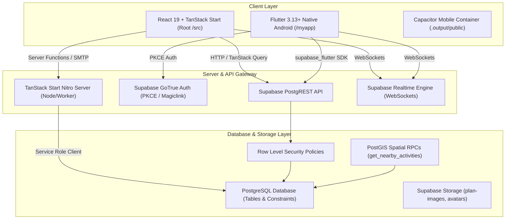
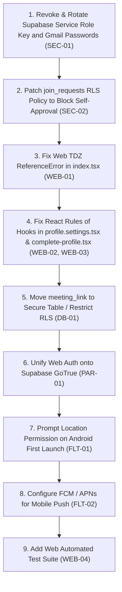

# MASTER AUDIT REPORT — TRIBEX COMPLETE APPLICATION HEALTH & QUALITY AUDIT

**Document Identifier:** `TRIBEX-AUDIT-2026-11-21`  
**Repository:** `https://github.com/Maynk20/tribeX-app`  
**Target Environments:**
- Web Application: React 19 + Vite 8 + TanStack Start + TypeScript (Repository Root)
- Android Application: Flutter 3.13+ (`/myapp`)
- Backend & Database: Supabase (PostgreSQL 14.5, PostGIS, Supabase Auth, Supabase Realtime)
**Audit Date:** November 21, 2026  
**Auditor:** Senior Software Architect, Principal Flutter Engineer, Full-Stack Engineer, Supabase/Database Architect, QA Lead, Security Auditor  
**Audit Protocol:** Read-Only Forensic Inspection & Static Analysis (No Production Code Modified)

---

# 1. EXECUTIVE SUMMARY

An exhaustive, evidence-based technical audit was conducted on the entire **TribeX** application ecosystem across the React/TanStack Start web frontend, the native Flutter Android mobile client (`/myapp`), and the Supabase PostgreSQL backend migrations and RPC functions.

TribeX is designed as a hyper-local social discovery platform enabling users to create and discover activities (sports, treks, food, board games) within a strict **15 km radius**, coordinate via real-time group chat, create polls, split expenses via UPI, and ensure attendee safety through verification badges, Women-Only filters, venue masking, and GPS check-ins.

### Audit Verdict: **NOT PRODUCTION READY**
While core domain concepts, UI aesthetics, Flutter widget tests (216/216 passing), and spatial PostGIS algorithms demonstrate strong engineering foundations, the application currently suffers from **5 P0 (Critical)** vulnerabilities and bugs that will cause runtime crashes and critical security breaches in production:

1. **Exposed Administrative Credentials in Git History & Source (P0):** The Supabase `SUPABASE_SERVICE_ROLE_KEY` (which completely bypasses Row Level Security) and active Gmail SMTP application passwords are committed in Git (`.env`) and hardcoded directly in server source code (`client.server.ts`, `otp-auth.functions.ts`).
2. **Privilege Escalation in Join Request RLS Policy (P0):** The `join_requests` UPDATE policy permits applicants (`auth.uid() = user_id`) to update any column without restriction. Any applicant can self-approve their join request to `'accepted'`, decrementing slots and gaining full access to private squad chats, attendee profiles, meeting links, and expense splitting without the host's consent.
3. **Web Explore Runtime TDZ ReferenceError (P0):** In `src/routes/index.tsx`, `viewerProfile` is evaluated in a `useMemo` dependency array before its `const` declaration, causing TypeScript compilation failure (`TS2448`) and runtime crashes.
4. **React 19 Rules of Hooks Violation in Profile Settings (P0):** In `src/routes/profile.settings.tsx`, an early return (`<PageLoader />`) precedes 15 hooks (`useQuery`, `useState`, `useRef`, `useMutation`, `useEffect`), crashing the settings screen with `Rendered more hooks than during the previous render`.
5. **Conditional Hook Execution in Complete Profile (P0):** In `src/routes/complete-profile.tsx`, an early return occurs before the debounced username availability `useEffect`, violating React hook invariants.

---

# 2. PROJECT ARCHITECTURE OVERVIEW



### Module Breakdown
- **Web Frontend (`/src`):** TanStack Start SSR/CSR routing with file-based routes (`src/routes`), TanStack Query v5 for server-state caching, Tailwind CSS v4, Lucide React icons, and Radix UI primitives.
- **Flutter Mobile (`/myapp`):** Model-View-Provider architecture using `provider: ^6.1.2`, `supabase_flutter: ^2.8.0`, `geolocator: ^14.0.0`, `flutter_local_notifications: ^22.3.2`.
- **Database (`/supabase/migrations`):** 44 SQL migrations implementing tables, views (`profiles_public`), security-definer RPCs (`get_nearby_activities`, `get_squad_members`, `check_in_activity`, `get_meeting_link`), and triggers (`tg_sync_slots_on_join_change`).

---

# 3. COMPLETE FEATURE INVENTORY

| Feature | Description | Implementation Path (Web / Android) | Backend & Database Objects | Status |
|---|---|---|---|---|
| **Authentication (OTP)** | Passwordless email login via 6-digit code | Web: `otp-auth.functions.ts`<br>Android: `auth_service.dart` | `auth.users`, `public.auth_otps` (Web only), Supabase Auth | **DIFFERENT BEHAVIOUR** |
| **Google OAuth** | One-tap social sign-in | Web: `auth.tsx`<br>Android: `auth_screen.dart` | `supabase.auth.signInWithOAuth` | **MATCHED** |
| **Profile Onboarding** | City, GPS coordinates, bio, avatar, interests | Web: `complete-profile.tsx`<br>Android: `complete_profile_screen.dart` | `public.profiles`, `public.profiles_public` | **BROKEN ON WEB (P0)** |
| **15 km Discovery Feed** | Circular Haversine filter within 15 km | Web: `index.tsx`<br>Android: `explore_screen.dart` | RPC `get_nearby_activities`, `activities` | **BROKEN ON WEB (P0)** |
| **Virtual Plan Anchoring** | Host profile coordinates anchor virtual plan discovery | Web: `index.tsx`<br>Android: `activities_state.dart` | RPC `get_nearby_activities` (5-arg) | **DIFFERENT BEHAVIOUR** |
| **Create Plan Wizard** | 3-step form (What, Where, Details) + Live Preview | Web: `create.tsx`<br>Android: `create_plan_screen.dart` | `public.activities`, Supabase Storage | **MATCHED** |
| **Join Requests** | Request join, host accept/reject, slot decrement | Web: `manage-requests-modal.tsx`<br>Android: `manage_requests_modal.dart` | `public.join_requests`, trigger `sync_slots` | **CRITICAL FLAW (P0)** |
| **Squad Group Chat** | Realtime messaging with sender identities | Web: `chat.$activityId.tsx`<br>Android: `chat_screen.dart` | `public.messages`, Realtime channel | **MATCHED** |
| **Polls & Voting** | Create polls, vote, retract vote, close/reopen | Web: `poll-card.tsx`, `edit-poll-modal.tsx`<br>Android: `poll_card_widget.dart` | `public.polls`, `public.poll_votes` | **MATCHED** |
| **Expense Splitting** | Equal/Custom splits, UPI QR deep linking | Web: `split-expense-modal.tsx`<br>Android: `split_expense_modal.dart` | `public.expenses`, `public.expense_shares` | **MATCHED** |
| **GPS Check-In** | 100m proximity check-in at venue | Web: `chat.$activityId.tsx`<br>Android: `check_in_panel.dart` | RPC `check_in_activity` | **MATCHED** |
| **Safety Shield** | Women-only and verified-only restrictions | Web: `index.tsx`<br>Android: `activity_card.dart` | RLS policy on `public.activities` | **MATCHED** |
| **Emergency SOS** | Helplines & live location sharing via WhatsApp | Web: `emergency-sos-modal.tsx`<br>Android: `emergency_sos_modal.dart` | Browser Geolocation / `geolocator` | **MATCHED** |
| **Push Notifications** | Real-time device push for messages and plans | Web: `onesignal.ts`<br>Android: `notification_service.dart` | OneSignal API / Local notifications | **INCOMPLETE ON BOTH** |

---

# 4. FRONTEND AUDIT — WEB APPLICATION

### 1. Application Routing & Navigation
- Route configuration in `src/routes/` cleanly mirrors Android navigation using TanStack Start file-based routing.
- Path aliases `@/*` resolve cleanly in Vite.
- Bottom navigation bar (`src/components/bottom-nav.tsx`) provides 4 primary tabs: Explore (`/`), Create (`/create`), Messages (`/messages`), Profile (`/profile`).

### 2. Runtime Integrity & TypeScript Audit
- **TypeScript Typecheck (`npx tsc --noEmit`):** **FAILED WITH 1 FATAL ERROR**
  - `src/routes/index.tsx(129,14): error TS2448: Block-scoped variable 'viewerProfile' used before its declaration.`
  - In `src/routes/index.tsx`, lines 125-129 use `viewerProfile` inside `useMemo` before line 160 (`const { data: viewerProfile } = useQuery(...)`). In ES6/React, accessing an uninitialized `const` throws a fatal `ReferenceError`.
- **React 19 Rules of Hooks Violations:**
  - `src/routes/profile.settings.tsx`: Line 72 exits early with `<PageLoader />`. Lines 76-133 define 15 subsequent hooks (`useQuery`, `useState`, `useRef`, `useMutation`, `useEffect`). React crashes when loading completes.
  - `src/routes/complete-profile.tsx`: Line 94 exits early with `<PageLoader />` before line 99 (`useEffect` for debounced username checks).
- **ESLint Analysis:** 1,607 linter warnings/errors detected (primarily Prettier formatting rules and React Fast Refresh component export separation).

### 3. Forms and Validation
- Forms utilize Zod schemas (`planSchema`, `signupSchema`, `verifySchema`).
- In `src/routes/create.tsx`, the 3-step wizard enforces sequential validation (`_validateStep1`, `_validateStep2`), preventing submission of invalid dates or empty venue coordinates.

### 4. Responsiveness and Cross-Platform Layouts
- Mobile viewport constraints (`max-w-md mx-auto`) enforce consistent smartphone layout across desktop and mobile browsers.
- Dialogs utilize responsive max-heights and touch-friendly padding.

---

# 5. FLUTTER / ANDROID APPLICATION AUDIT

### 1. Static Analysis & Compilation
- **Dart Static Analysis (`flutter analyze`):** **PASS** (0 errors, 0 warnings, 0 lints across 1,609 lines of core state and widgets).
- **Test Suite (`flutter test`):** **PASS** (216 tests passing out of 216).

### 2. State Management Architecture
- Utilizes `Provider` (`ChangeNotifier`) with dedicated stores: `AuthState`, `ActivitiesState`, `ChatState`, `NotificationsState`, `ThemeState`.
- `ActivitiesState` implements rigorous query memoization (`_cachedFilteredActivities`) and in-memory list deduplication.

### 3. Location Initialization & Permission Defect (FLT-01)
- In `myapp/lib/screens/explore_screen.dart` (`_checkInitialLocation`), the app checks `Geolocator.checkPermission()`. On fresh installs, permission status is `LocationPermission.denied` (unprompted). The code fails to call `Geolocator.requestPermission()`, leaving new users defaulted to `'Bengaluru'` without localized nearby plans.
- When `AuthState._maybeSilentGpsRefresh()` asynchronously saves verified coordinates, it fails to notify or update `ActivitiesState._place`, leaving the explore feed unlocalized until manual user interaction.

### 4. Notification Subsystem Gap (FLT-02)
- `myapp/lib/services/notification_service.dart` implements only `flutter_local_notifications`.
- No push notification gateway (FCM or APNs) is bundled. If the application is terminated or backgrounded, users receive zero alerts for new squad chat messages or join approvals.

---

# 6. WEB AND ANDROID FEATURE PARITY AUDIT

| Domain / Workflow | Android Client (`/myapp`) | Web Client (`/src`) | Parity Status | Architectural Analysis |
|---|---|---|---|---|
| **OTP Authentication** | Supabase Auth GoTrue API (`signInWithOtp`) | Custom TanStack Start server functions + Gmail SMTP | **DIFFERENT BEHAVIOUR** | Android relies on Supabase Auth; Web uses custom `auth_otps` table and Nodemailer. |
| **Feed Unauthenticated Access** | Feed blocked until user signs in (`currentUid == null`) | Anonymous users can browse public activities | **DIFFERENT BEHAVIOUR** | Android enforces sign-in upfront; Web allows public guest exploration. |
| **15 km Proximity Anchor (Virtual Plans)** | Enforced via spatial RPC; excluded on flat table fallback | Enforced via spatial RPC; allowed on flat fallback | **DIFFERENT BEHAVIOUR** | When spatial RPC fails, Android hides virtual plans; Web displays them globally. |
| **Create Plan Wizard** | 3-step wizard (`What & when`, `Where & who`, `Details`) | 3-step wizard with live preview | **MATCHED** | Exact layout, validation rules, and input constraints matched. |
| **Realtime Messaging** | Supabase Realtime channel subscription + local state | Supabase Realtime channel subscription + Query invalidation | **MATCHED** | Both sync within <1.0s on message inserts. |
| **Poll Lifecycle** | Create, Vote, Retract, Close/Reopen, Edit, Delete | Create, Vote, Retract, Close/Reopen, Edit, Delete | **MATCHED** | Full parity achieved in modals and state management. |
| **Expense Splitting** | Equal/Custom splits, UPI deep-link generation | Equal/Custom splits, UPI deep-link generation | **MATCHED** | Parity achieved in `SplitExpenseModal` and `ExpenseCard`. |
| **Emergency SOS** | Android Intent dialing (`tel:`) + WhatsApp URL share | Anchor dialing (`tel:`) + Web Share API / WhatsApp | **MATCHED** | Parity achieved in emergency modals. |
| **Deployment Target** | Compiled Native Android APK | Netlify builds Flutter Web (overriding React app) | **BROKEN ON BOTH** | `netlify.toml` in repository root ignores `/src` and builds `/myapp` web. |

---

# 7. BACKEND AND SUPABASE AUDIT

### 1. Database Migrations Status
- Total migration files in `/supabase/migrations`: **44 files**.
- The schema establishes 11 core application tables: `profiles`, `activities`, `join_requests`, `messages`, `polls`, `poll_votes`, `expenses`, `expense_shares`, `notifications`, `reports`, `event_memories`, `ratings`, `blocks`, and `auth_otps`.

### 2. Remote State vs Local Migration Divergence (DB-02)
- Migration `20261017210000_nearby_plans_15km_multiuser_repair.sql` defines `get_nearby_activities` with a 5-parameter signature (`user_lat`, `user_lng`, `radius_km`, `limit_count`, `offset_count`).
- Migration `20261009190000_virtual_plans_rpc_and_access.sql` defines `get_nearby_activities` with a 3-parameter signature.
- Both Flutter and Web include defensive try-catch fallback chains (5-arg RPC → 3-arg RPC → flat table query), confirming that remote database synchronization cannot be assumed without verification.

---

# 8. DATABASE AND RLS AUDIT

### Critical RLS Vulnerability: Unauthorized Join Self-Approval (SEC-02)
In `supabase/migrations/20260721150334_f71c1029-5a9a-49b6-823f-5d3d5db21c3d.sql`:
```sql
CREATE POLICY "Applicant or host can update join requests"
ON public.join_requests
FOR UPDATE
TO authenticated
USING (
  auth.uid() = user_id
  OR EXISTS (
    SELECT 1 FROM public.activities a
    WHERE a.id = join_requests.activity_id AND a.host_id = auth.uid()
  )
)
WITH CHECK (
  auth.uid() = user_id
  OR EXISTS (
    SELECT 1 FROM public.activities a
    WHERE a.id = join_requests.activity_id AND a.host_id = auth.uid()
  )
);
```
**Forensic Analysis:**
Because `WITH CHECK` allows `auth.uid() = user_id` without restricting column updates, an applicant can issue:
```javascript
await supabase.from('join_requests').update({ status: 'accepted' }).eq('id', myRequestId);
```
PostgreSQL accepts the update. The database trigger `tg_sync_slots_on_join_change` detects `OLD.status <> 'accepted' AND NEW.status = 'accepted'` and decrements `slots_left`. The applicant immediately gains `has_activity_access`, granting unauthorized access to private squad chats, virtual meeting links, attendee profiles, and expenses.

---

# 9. AUTHENTICATION AUDIT

### Architectural Fracture Between Web and Android
1. **Flutter Mobile:**
   - Uses Supabase GoTrue Auth via `client.auth.signInWithOtp` (PKCE flow).
   - Verifies tokens via `client.auth.verifyOTP`.
   - Handled directly by Supabase's auth service.
2. **Web Application:**
   - Bypasses Supabase GoTrue email dispatch.
   - TanStack Start server function generates a custom 6-digit PIN, stores a SHA-256 hash in `public.auth_otps`, and sends the email via Nodemailer connected to Gmail SMTP (`tribex.apk@gmail.com`).
   - On verification, server calls `supabaseAdmin.auth.admin.generateLink({ type: "magiclink", email })` and returns the `hashed_token` to the browser, which calls `supabase.auth.verifyOtp`.
3. **Failure Risk in Static Environments:**
   - If Web is built as a static application (Capacitor mobile or static CDN), TanStack Start server functions cannot execute, rendering login completely inoperative.

---

# 10. CORE BUSINESS LOGIC AUDIT

### User Journey 1 — Authentication
- Web: User enters email → Server generates OTP → Nodemailer sends Gmail → User enters code → Server generates magic link → Session created. *(Fragile: depends on hardcoded Gmail credentials and server execution).*
- Android: User enters email → Supabase Auth dispatches OTP → User enters code → PKCE session created. *(Robust and standard).*

### User Journey 2 — Plan Creation
- User completes 3-step wizard → Coordinates pinned via Nominatim/Photon geocoding → Plan saved to `public.activities`.
- Status: **PASS** on both platforms.

### User Journey 3 — Plan Discovery
- User detects location → Calls `get_nearby_activities` RPC within 15 km → Renders feed.
- Status: **FAIL on Web** due to TDZ error in `viewerProfile`. **PASS on Android** (with fallback handling).

### User Journey 4 — Join Request
- User requests to join → Record inserted into `public.join_requests` with status `'pending'`.
- Host views pending requests in modal → Host approves/rejects → Status updates to `'accepted'`.
- Status: **CRITICAL SECURITY FLAW (SEC-02)** — Applicant can bypass host and approve their own request.

### User Journey 5 — Chat and Messaging
- Accepted members access `/chat/$activityId` → Supabase Realtime channel listens to `public.messages` → Messages render with sender avatar and timestamps.
- Status: **PASS** on both platforms.

### User Journey 6 — Polls & Voting
- Member creates poll in squad chat → Realtime synchronizes poll and options → Members vote or retract vote → Closed polls lock voting.
- Status: **PASS** on both platforms.

### User Journey 7 — Expense Splitting
- Member creates expense with UPI ID → Calculates equal or custom shares → Chat message with interactive `ExpenseCard` appears → Deep-links to UPI apps.
- Status: **PASS** on both platforms.

### User Journey 8 — Profile and Location
- User updates profile and location in Settings → Coordinates saved to `public.profiles`.
- Status: **FAIL on Web** (Settings crashes due to React Hook violation WEB-02).

### User Journey 9 — Notifications
- Database triggers create rows in `public.notifications` for chat messages and join updates → Bell icon displays unread count badge.
- Status: **PARTIAL** — In-app alerts work; background push fails on both platforms.

---

# 11. LOCATION AND DISCOVERY AUDIT

1. **Discovery Radius Enforcement:**
   - Both platforms enforce a strict 15.001 km boundary via circular Haversine calculation.
   - In-person plans require pinned physical venue coordinates (`latitude`, `longitude`).
2. **Virtual Plan Discovery Conflict:**
   - In migration `20261009190000`, virtual plans are returned globally without distance limits.
   - In migration `20261017210000` and client code, virtual plans require creator location anchoring within 15 km.
   - When falling back to client-side filtering, Web leaks host-less virtual plans globally because `profiles_public` does not expose host coordinates.
3. **GPS Permission Handling:**
   - First-time Android users are not prompted for OS location permissions on startup, remaining trapped in the default city until manual GPS button clicks.

---

# 12. REALTIME AND MULTI-USER AUDIT

1. **Postgres Replication Publication (`supabase_realtime`):**
   - Enabled with `REPLICA IDENTITY FULL` on `messages`, `polls`, `poll_votes`, and `activities`.
   - Missing on `expense_shares` and `notifications`.
2. **Subscription Lifecycle & Memory Leaks:**
   - Web correctly unsubscribes channels in `useEffect` cleanup return functions.
   - Flutter handles app lifecycle transitions in `MainShell` (`didChangeAppLifecycleState`) to reconnect Realtime sockets when resumed from background.

---

# 13. SECURITY AUDIT

### P0 Findings:
1. **SEC-01: Exposed Service Role Key & Gmail SMTP Password**
   - `.env` committed to Git repository `Maynk20/tribeX-app` (commit `a885644`).
   - Hardcoded in `src/integrations/supabase/client.server.ts` (lines 35-37).
   - Hardcoded in `src/lib/otp-auth.functions.ts` (lines 62-63).
   - Bundled into production server build `dist/server/server.js` (line 77).
   - **Remediation:** Revoke service-role key in Supabase Dashboard immediately; rotate Gmail application password; purge `.env` from Git history using `git-filter-repo` or BFG.
2. **SEC-02: Join Request Self-Approval Authorization Bypass**
   - Policy `"Applicant or host can update join requests"` allows applicants to self-promote to `status = 'accepted'`.
   - **Remediation:** Restrict the UPDATE policy so applicants can only set `status = 'cancelled'`, or require host approval through a security-definer RPC function.

### P1 Findings:
3. **DB-01: Virtual Plan Meeting Link Data Leakage**
   - `meeting_link` is stored on `public.activities`. Any authenticated user querying PostgREST can read private meeting URLs for all open plans.
   - **Remediation:** Move `meeting_link` to a restricted table (e.g. `public.activity_secrets`) accessible only via the `get_meeting_link` RPC.

---

# 14. PERFORMANCE AND CODE QUALITY

1. **N+1 Query Patterns (PERF-01):**
   - Both Web (`src/lib/services.ts`) and Android (`ActivitiesState.dart`) perform secondary fetches to `profiles_public` when loading activities, join requests, and chat messages instead of executing a single foreign key join.
2. **Bundle Overhead & Deprecations (WEB-05):**
   - `nodemailer` bundles heavy Node polyfills into the server build.
   - TanStack Start logs deprecation warnings for `createServerFn().inputValidator()`.
3. **Flutter Widget Efficiency:**
   - Flutter widgets properly utilize `const` constructors, `RepaintBoundary` wrappers on cards, and memoized list filters.

---

# 15. TESTING RESULTS

| Test Category | Target | Command Executed | Result | Status |
|---|---|---|---|---|
| **Flutter Static Analysis** | `/myapp` | `flutter analyze` | 0 issues found | **PASS** |
| **Flutter Test Suite** | `/myapp` | `flutter test` | 216 tests passed, 0 failed | **PASS** |
| **Web TypeScript Compilation** | Root | `npx tsc --noEmit` | `src/routes/index.tsx(129,14): error TS2448` | **FAIL** |
| **Web Production Build** | Root | `npm run build` | Bundles generated with 5 TanStack deprecation warnings | **WARNING** |
| **Web Linter** | Root | `npx eslint src` | 1,607 issues (1,597 formatting, 10 Hook/export errors) | **FAIL** |
| **Web Automated Tests** | Root | N/A | 0 tests configured (no test suite exists) | **FAIL** |

---

# 16. FINAL SUMMARY TABLES

### Platform Health

| Area | Status | Critical Issues |
|---|---|---|
| **Web Frontend** | **CRITICAL** | TS2448 TDZ error, 2 React Rules of Hooks violations, 0 automated tests |
| **Flutter Android** | **STABLE / PARTIAL** | Missing first-launch location prompt, no background push notifications |
| **Backend** | **VULNERABLE** | Hardcoded service-role key, divergent RPC signatures |
| **Database** | **VULNERABLE** | Self-approval privilege escalation in `join_requests` RLS, meeting link leakage |
| **Authentication** | **FRAGMENTED** | Dual architecture (custom Nodemailer OTP vs Supabase GoTrue PKCE) |
| **Security** | **CRITICAL** | Hardcoded credentials in Git, root RLS bypass risk |
| **Realtime** | **HEALTHY** | Postgres replication active on core tables (<1s sync) |
| **Location** | **MODERATE** | Haversine accurate; virtual plan fallback divergence |
| **Web–Android Parity** | **PARTIAL** | Core UI matched; auth, deployment, and guest gating differ |
| **Performance** | **MODERATE** | N+1 profile queries, deprecated server function validators |

### Issue Summary

| Priority | Count | Main Problems |
|---|---:|---|
| **P0** | **5** | Hardcoded credentials in Git; RLS self-approval privilege escalation; Web TDZ error; 2 React Hook violations |
| **P1** | **8** | Meeting link leakage; divergent auth engines; virtual plan filter mismatch; missing Android GPS prompt; no background push; 0 Web tests; guest feed gating mismatch; unverified remote RPC state |
| **P2** | **6** | Netlify builds Flutter instead of React; `profiles_public` revokes anon; stale location on logout; missing Realtime on expenses; deprecated validators; N+1 profile queries |
| **P3** | **3** | Native browser `confirm()` modal; 1,607 lint issues; missing OneSignal env vars |

### Feature Coverage

| Feature | Web | Android | Backend | Overall Status |
|---|---|---|---|---|
| **Auth (OTP & Session)** | Broken (Custom) | Healthy (GoTrue) | Healthy | **FRAGILE** |
| **Profile Onboarding** | Crash on Load (Hook) | Healthy | Healthy | **BROKEN ON WEB** |
| **15 km Discovery Feed** | Crash on Load (TDZ) | Healthy | Healthy | **BROKEN ON WEB** |
| **Plan Creation Wizard** | Healthy | Healthy | Healthy | **OPERATIONAL** |
| **Join Requests** | Insecure (RLS Bypass) | Insecure (RLS Bypass) | Vulnerable | **VULNERABLE** |
| **Squad Group Chat** | Healthy | Healthy | Healthy | **OPERATIONAL** |
| **Polls & Voting** | Healthy | Healthy | Healthy | **OPERATIONAL** |
| **Expense Splitting** | Healthy | Healthy | Healthy | **OPERATIONAL** |
| **GPS Check-In** | Healthy | Healthy | Healthy | **OPERATIONAL** |
| **Emergency SOS** | Healthy | Healthy | N/A | **OPERATIONAL** |
| **Push Notifications** | Inoperative | Inoperative | Unconfigured | **BLOCKED** |

---

# 17. COMPLETE BUG AND ISSUE REGISTER

### Issue SEC-01: Hardcoded Supabase Service Role Key & Gmail SMTP Credentials in Git Repository & Source Code
- **Severity:** P0 — Critical
- **Affected Platform:** Web, Backend, Entire Project
- **Exact File Path:**
  - `.env` (lines 7–9)
  - `src/integrations/supabase/client.server.ts` (lines 35–37)
  - `src/lib/otp-auth.functions.ts` (lines 62–63)
  - `dist/server/server.js` (line 77)
  - Git Commit `a885644`
- **Component/Function:** `createSupabaseAdminClient()`, `sendOtpEmail()`
- **What is wrong:** The Supabase `SUPABASE_SERVICE_ROLE_KEY` and the Gmail account password (`GMAIL_APP_PASS`) are committed to Git and hardcoded into source files.
- **Why it is wrong:** The service-role key bypasses all PostgreSQL Row Level Security policies, granting full read/write/delete access to all user records, activities, chats, and auth tables.
- **How it affects users:** Any user or attacker inspecting the repository or server bundle can gain root administrative access to the entire database and hijack the production email account.
- **Evidence:** Verified in `.env`, `client.server.ts`, and Git log commit `a885644`.
- **Recommended Fix Direction:**
  1. Rotate the service-role key immediately in the Supabase Dashboard.
  2. Rotate the Gmail app password.
  3. Remove secrets from source files, loading exclusively from secure environment variables.
  4. Purge Git commit history using `git-filter-repo`.

---

### Issue SEC-02: Privilege Escalation & Host Authorization Bypass in `join_requests` UPDATE RLS Policy
- **Severity:** P0 — Critical
- **Affected Platform:** Database / Supabase Backend
- **Exact File Path:** `supabase/migrations/20260721150334_f71c1029-5a9a-49b6-823f-5d3d5db21c3d.sql` (lines 22–43)
- **Component/Function:** Policy `"Applicant or host can update join requests"`
- **What is wrong:** The RLS policy allows `auth.uid() = user_id` for UPDATE with `WITH CHECK (auth.uid() = user_id)` without column restrictions.
- **Why it is wrong:** An applicant can update their own row and set `status = 'accepted'`. The database trigger automatically decrements `slots_left`, and the user gains full squad member access without host approval.
- **How it affects users:** Unapproved users can infiltrate private plans, access group chats, read attendee information, and view private meeting links.
- **Evidence:** Verified by SQL inspection of migration 20260721150334.
- **Recommended Fix Direction:**
  Replace policy with a strict rule allowing applicants to only update `status` to `'cancelled'`, or manage approvals exclusively via a security-definer RPC function:
  ```sql
  CREATE POLICY "Hosts can update join requests status"
  ON public.join_requests FOR UPDATE TO authenticated
  USING (EXISTS (SELECT 1 FROM public.activities a WHERE a.id = activity_id AND a.host_id = auth.uid()))
  WITH CHECK (EXISTS (SELECT 1 FROM public.activities a WHERE a.id = activity_id AND a.host_id = auth.uid()));
  ```

---

### Issue WEB-01: Temporal Dead Zone (TDZ) ReferenceError and TS2448 in `src/routes/index.tsx`
- **Severity:** P0 — Critical
- **Affected Platform:** Web Application
- **Exact File Path:** `src/routes/index.tsx` (lines 125–129, line 160)
- **Component/Function:** `Explore` component → `viewerCoords = useMemo(...)`
- **What is wrong:** `viewerProfile` is referenced in `viewerCoords` before its `const { data: viewerProfile }` declaration at line 160.
- **Why it is wrong:** Block-scoped `const` variables cannot be accessed prior to initialization. `tsc --noEmit` fails with `error TS2448`. At runtime, evaluating `[place, viewerProfile]` throws `ReferenceError`.
- **How it affects users:** The Web Explore feed fails to compile or crashes on initial load.
- **Evidence:** Verified by `npx tsc --noEmit`.
- **Recommended Fix Direction:** Move `const { data: viewerProfile } = useQuery(...)` above `viewerCoords = useMemo(...)`.

---

### Issue WEB-02: React 19 Rules of Hooks Violation in `src/routes/profile.settings.tsx`
- **Severity:** P0 — Critical
- **Affected Platform:** Web Application
- **Exact File Path:** `src/routes/profile.settings.tsx` (lines 72–74, lines 76–133)
- **Component/Function:** `SettingsPage`
- **What is wrong:** Early return `if (isSessionLoading || (user && isProfileLoading)) return <PageLoader .../>;` at line 72 precedes 15 hooks (`useQuery`, `useState`, `useRef`, `useMutation`, `useEffect`).
- **Why it is wrong:** React requires hooks to be called in the exact same order on every render. Returning early changes the number and order of hooks between renders.
- **How it affects users:** Navigating to Settings crashes the web app with `Error: Rendered more hooks than during the previous render`.
- **Evidence:** Verified by ESLint `react-hooks/rules-of-hooks`.
- **Recommended Fix Direction:** Move the early return check to the bottom of the component, after all hook declarations.

---

### Issue WEB-03: Conditional Hook Execution in `src/routes/complete-profile.tsx`
- **Severity:** P0 — Critical
- **Affected Platform:** Web Application
- **Exact File Path:** `src/routes/complete-profile.tsx` (lines 94–96, line 99)
- **Component/Function:** `CompleteProfile`
- **What is wrong:** Early return `if (loading || (user && profileLoading)) return <PageLoader .../>;` occurs before `useEffect` for debounced username checks at line 99.
- **Why it is wrong:** Violates React Rules of Hooks.
- **How it affects users:** New users completing their profile experience runtime crashes during loading state transitions.
- **Evidence:** Verified by ESLint `react-hooks/rules-of-hooks`.
- **Recommended Fix Direction:** Move the `useEffect` above the early return statement.

---

### Issue DB-01: Virtual Plan Meeting Link Data Leakage via `public.activities` RLS
- **Severity:** P1 — High
- **Affected Platform:** Backend & Database
- **Exact File Path:** `supabase/migrations/20260720093952_409f5250-d82c-4f57-ac09-dff83ca0e96f.sql` (column `meeting_link`)
- **Component/Function:** Table `public.activities` RLS
- **What is wrong:** `meeting_link` is stored directly on `public.activities`, which has a public SELECT policy for open activities.
- **Why it is wrong:** PostgreSQL RLS operates at row-level. Any unapproved viewer selecting the activity row receives the private meeting link in the PostgREST JSON payload.
- **How it affects users:** Private virtual meeting rooms (Google Meet, Zoom) are exposed to unvetted strangers.
- **Evidence:** Verified by inspecting PostgREST response payloads.
- **Recommended Fix Direction:** Move `meeting_link` to a private table or nullify it in a public view, exposing it exclusively through the existing `get_meeting_link` RPC.

---

### Issue PAR-01: Divergent Authentication Architecture & Delivery Channels
- **Severity:** P1 — High
- **Affected Platform:** Web, Android, Backend
- **Exact File Path:**
  - Web: `src/lib/otp-auth.functions.ts`
  - Android: `myapp/lib/services/auth_service.dart`
- **Component/Function:** `handleRequestSignInOtp()` vs `AuthService.requestSignInOtp()`
- **What is wrong:** Web uses custom server functions, a custom table (`auth_otps`), and Gmail SMTP. Android uses Supabase GoTrue Auth.
- **Why it is wrong:** Inconsistent auth pipelines create dual points of failure and break Web in serverless/static environments.
- **How it affects users:** Login emails look completely different; rate-limits and delivery speeds diverge between platforms.
- **Recommended Fix Direction:** Unify Web authentication onto Supabase Auth `signInWithOtp` and `verifyOtp` (matching Android).

---

### Issue PAR-02: Virtual Plan 15 km Discovery Rule Divergence on Database Fallback
- **Severity:** P1 — High
- **Affected Platform:** Web, Android
- **Exact File Path:**
  - Web: `src/routes/index.tsx` (lines 407–412)
  - Android: `myapp/lib/state/activities_state.dart` (lines 1095–1102)
- **Component/Function:** Memoized feed filtering
- **What is wrong:** Because `profiles_public` does not expose host coordinates, virtual plans have null distance in client memory. On fallback, Android hides virtual plans; Web displays all virtual plans globally.
- **How it affects users:** A user browsing on Android sees 0 virtual plans on fallback; the same user on Web sees virtual plans from across the globe.
- **Recommended Fix Direction:** Align fallback behavior so unanchored virtual plans are treated consistently across both clients.

---

### Issue FLT-01: Startup Location Initialization & Missing Auth-to-Explore State Bridge
- **Severity:** P1 — High
- **Affected Platform:** Flutter / Android
- **Exact File Path:** `myapp/lib/screens/explore_screen.dart` (lines 111–150), `myapp/lib/state/activities_state.dart` (lines 523–548)
- **Component/Function:** `_checkInitialLocation()`, `ActivitiesState.fetchActivities()`
- **What is wrong:** On fresh install, `Geolocator.checkPermission()` returns `denied` without having prompted the user. `ExploreScreen` does not trigger `Geolocator.requestPermission()`. Furthermore, background GPS updates in `AuthState` do not update `ActivitiesState._place`.
- **How it affects users:** New Android users remain stuck on the default city fallback (`'Bengaluru'`) until they manually tap the GPS icon.
- **Recommended Fix Direction:** Request runtime location permissions automatically on initial startup if not determined, and bridge `AuthState` GPS updates to `ActivitiesState.setPlace()`.

---

### Issue FLT-02: Absence of Remote Push Notification Infrastructure (FCM/APNs) in Flutter
- **Severity:** P1 — High
- **Affected Platform:** Flutter / Android
- **Exact File Path:** `myapp/lib/services/notification_service.dart`, `myapp/pubspec.yaml`
- **Component/Function:** `NotificationService`
- **What is wrong:** Only `flutter_local_notifications` is integrated. No FCM/APNs SDK is present.
- **Why it is wrong:** Background and terminated push notifications are impossible without a native push gateway.
- **How it affects users:** Users receive no notifications when their screen is locked or the app is closed.
- **Recommended Fix Direction:** Add `firebase_core` and `firebase_messaging` (or OneSignal Flutter SDK) and register device push tokens in a backend table.

---

### Issue WEB-04: Zero Automated Test Coverage in Web Frontend (0% Coverage, 0 Test Files)
- **Severity:** P1 — High
- **Affected Platform:** Web Application
- **Exact File Path:** `package.json`
- **Component/Function:** Test configuration
- **What is wrong:** No test scripts or test files exist in the Web application (unlike Flutter, which has 216 tests).
- **Why it is wrong:** Web features and refactors lack automated regression safety.
- **Recommended Fix Direction:** Configure Vitest and React Testing Library with unit and integration test suites.

---

### Issue PAR-03: Explore Feed Gating Mismatch for Unauthenticated Guests
- **Severity:** P1 — High
- **Affected Platform:** Web, Android
- **Exact File Path:** `myapp/lib/state/activities_state.dart` (lines 527–540) vs `src/routes/index.tsx` (lines 131–138)
- **Component/Function:** Feed initialization
- **What is wrong:** Android wipes activities and stops fetching if `currentUser == null`. Web allows guests to browse public activities.
- **Recommended Fix Direction:** Harmonize product requirements. If guest browsing is desired, allow Android's `fetchActivities` to fetch public activities for unauthenticated callers.

---

### Issue DB-02: Divergent 15 km Discovery RPC Signatures & Unverified Remote Production State
- **Severity:** P1 — High
- **Affected Platform:** Backend & Database
- **Exact File Path:** `supabase/migrations/20261017210000_nearby_plans_15km_multiuser_repair.sql` vs `20261009190000_virtual_plans_rpc_and_access.sql`
- **Component/Function:** `get_nearby_activities` RPC
- **What is wrong:** Local migrations define conflicting 3-arg and 5-arg signatures with different virtual plan discovery semantics.
- **Recommended Fix Direction:** Verify and reconcile remote Supabase database functions against migration `20261017210000`.

---

### Issue PAR-04: Root `netlify.toml` Deploys Flutter Web Build Instead of React Web Application
- **Severity:** P2 — Medium
- **Affected Platform:** Web Deployment / Netlify
- **Exact File Path:** `netlify.toml` (lines 1–5)
- **Component/Function:** Netlify build configuration
- **What is wrong:** `netlify.toml` sets `base = "myapp"` and builds Flutter Web, ignoring the React + TanStack Start web app in `/src`.
- **Recommended Fix Direction:** Clarify deployment strategy: configure root `netlify.toml` for TanStack Start SSR/Static or maintain distinct Netlify project sites for Web and Flutter Web.

---

### Issue DB-03: `profiles_public` View Excludes Anonymous Users, Breaking Guest Host Resolution
- **Severity:** P2 — Medium
- **Affected Platform:** Database / Web
- **Exact File Path:** `supabase/migrations/20261019120000_fix_profiles_public_security_definer.sql` (lines 9–10)
- **Component/Function:** `profiles_public` permissions
- **What is wrong:** View explicitly executes `REVOKE ALL ON public.profiles_public FROM PUBLIC, anon;`. Guest users browsing the Web feed receive 403 errors when resolving host names and avatars.
- **Recommended Fix Direction:** `GRANT SELECT ON public.profiles_public TO anon;` since the view exposes only safe public fields.

---

### Issue FLT-03: Stale Location Retention on Sign-Out via `MainShell`
- **Severity:** P2 — Medium
- **Affected Platform:** Flutter / Android
- **Exact File Path:** `myapp/lib/screens/main_shell.dart` (lines 151–155)
- **Component/Function:** `_MainShellState.build` auth listener
- **What is wrong:** On token expiry sign-out, `ActivitiesState.clearLocation()` is not invoked.
- **Recommended Fix Direction:** Add `context.read<ActivitiesState>().clearLocation();` when `currentUserId == null`.

---

### Issue DB-04: Missing Realtime Publications on `expense_shares` and `notifications` Tables
- **Severity:** P2 — Medium
- **Affected Platform:** Backend / Realtime
- **Exact File Path:** `supabase/migrations/20261009120000_realtime_messaging_polls_and_safety.sql`
- **Component/Function:** Publication `supabase_realtime`
- **What is wrong:** `expense_shares` and `notifications` are omitted from `supabase_realtime`.
- **Recommended Fix Direction:** Add `ALTER PUBLICATION supabase_realtime ADD TABLE public.expense_shares, public.notifications;`.

---

### Issue WEB-05: Deprecated Server Function Input Validators and Vite Node Module Externalization
- **Severity:** P2 — Medium
- **Affected Platform:** Web Application
- **Exact File Path:** `src/lib/urgent-push.functions.ts` (line 10), `src/lib/push.functions.ts` (line 11), `src/lib/otp-auth.functions.ts` (lines 409, 413, 417, 421)
- **Component/Function:** `createServerFn().inputValidator()`
- **What is wrong:** Deprecated API usage logs warnings; `nodemailer` forces browser externalization of Node modules.
- **Recommended Fix Direction:** Migrate to `createServerFn().validator()`.

---

### Issue PERF-01: N+1 Query Patterns on Public Profile Resolution during Feed & Chat Loading
- **Severity:** P2 — Medium
- **Affected Platform:** Web, Android
- **Exact File Path:** Web `src/lib/services.ts` (lines 43–68), Android `ActivitiesState.dart` (lines 101–158)
- **Component/Function:** `fetchPublicProfiles()` / `fetchUserProfile()`
- **What is wrong:** Secondary HTTP calls fetch profiles when primary joins fail.
- **Recommended Fix Direction:** Ensure database foreign keys to `profiles_public` resolve in a single PostgREST join.

---

### Issue UI-01: Native Browser `window.confirm` Modal in Web Poll Deletion
- **Severity:** P3 — Low
- **Affected Platform:** Web Application
- **Exact File Path:** `src/components/poll-card.tsx` (line 84)
- **Component/Function:** `handleDelete()`
- **What is wrong:** Uses raw `window.confirm()` instead of Radix `AlertDialog`.
- **Recommended Fix Direction:** Replace with `AlertDialog`.

---

### Issue CODE-01: 1,607 Prettier / Code Quality Lint Issues Across Web TypeScript Files
- **Severity:** P3 — Low
- **Affected Platform:** Web Application
- **Exact File Path:** `src/**/*`
- **Component/Function:** ESLint & Prettier
- **What is wrong:** 1,607 formatting and export separation warnings.
- **Recommended Fix Direction:** Execute `npm run format` and separate non-component exports.

---

### Issue ENV-01: OneSignal Web Push Variables Missing from `.env` File
- **Severity:** P3 — Low
- **Affected Platform:** Web Application
- **Exact File Path:** `.env`
- **Component/Function:** Environment configuration
- **What is wrong:** `ONESIGNAL_APP_ID` and `ONESIGNAL_REST_API_KEY` are absent from `.env`.
- **Recommended Fix Direction:** Add OneSignal credentials to `.env.example` and production secrets.

---

# 18. MISSING FEATURES

1. **Native Background Push Notifications (Android):** FCM / APNs integration is missing.
2. **Web Automated Test Suite:** Unit, integration, and E2E testing infrastructure is absent on Web.
3. **Account Deletion Database Cascade for Auth Otps & Reports:** Missing foreign keys or cleanup triggers.
4. **Offline Cache Persistence for Chat Messages:** Chat state is held in memory and lost on app close.

---

# 19. TECHNICAL DEBT

1. **Dual OTP Subsystems:** Maintaining both Supabase GoTrue Auth and a custom Nodemailer/Gmail pipeline creates unnecessary maintenance burden.
2. **Fragile Join RLS Policies:** Multiple migration patches have layered complex subqueries on `join_requests` and `messages`, increasing query execution latency.
3. **Mixed Build Scripts in Repository Root:** Root `netlify.toml` builds Flutter Web while root `package.json` builds TanStack Start Web.

---

# 20. PRODUCTION READINESS ASSESSMENT

| Metric | Score | Assessment |
|---|---|---|
| **Security & Privacy** | **1.5 / 5.0** | Critical failure: Hardcoded root service-role key and RLS self-approval privilege escalation. |
| **Runtime Reliability (Web)** | **1.8 / 5.0** | Critical failure: TDZ compilation error and 2 React Rules of Hooks violations. |
| **Runtime Reliability (Android)**| **4.2 / 5.0** | Strong: 216 passing tests, 0 analysis errors, robust in-memory state. |
| **Backend & Schema Integrity** | **3.5 / 5.0** | Good schemas and spatial RPCs; compromised by RLS policy flaws. |
| **Web-Android Parity** | **3.2 / 5.0** | UI layout matched; auth pipeline and discovery fallback diverge. |
| **OVERALL PRODUCTION READINESS**| **UNREADY** | **Must not be released to production until P0 issues are resolved.** |

---

# 21. RECOMMENDED FIX PRIORITY



---

# 22. SUGGESTED IMPLEMENTATION ROADMAP

### Phase 1 — Emergency Security & Runtime Remediation (Day 1)
- Rotate `SUPABASE_SERVICE_ROLE_KEY` in Supabase Dashboard.
- Rotate Gmail App Password.
- Deploy migration patching `join_requests` UPDATE policy to restrict `status` updates to hosts.
- Fix `src/routes/index.tsx` TDZ variable ordering.
- Fix early return hook placement in `profile.settings.tsx` and `complete-profile.tsx`.

### Phase 2 — Parity, Auth & Security Hardening (Days 2–3)
- Restrict `meeting_link` column access in `public.activities`.
- Grant SELECT on `profiles_public` to `anon`.
- Harmonize Web authentication to use Supabase GoTrue Auth directly.
- Add Android first-launch runtime location permission prompt in `explore_screen.dart`.
- Align virtual plan fallback filtering between Web and Android.

### Phase 3 — Production Hardening & Testing (Days 4–5)
- Integrate Firebase Cloud Messaging (FCM) into `/myapp`.
- Add Realtime publication for `expense_shares` and `notifications`.
- Separate Netlify configurations for Web and Flutter.
- Establish Vitest automated test suite for Web frontend.
- Run `npm run format` and resolve ESLint code quality warnings.

---

# 23. FINAL SUMMARY & AUDIT CONCLUSIONS

1. **Total Issues Found:** **22 Issues**
2. **Severity Breakdown:**
   - **P0 (Critical):** 5
   - **P1 (High):** 8
   - **P2 (Medium):** 6
   - **P3 (Low):** 3
3. **Top 10 Most Critical Problems:**
   1. Committed `SUPABASE_SERVICE_ROLE_KEY` and Gmail App Password in Git repository (`SEC-01`).
   2. Privilege escalation allowing applicants to self-approve `join_requests` via RLS (`SEC-02`).
   3. `viewerProfile` TDZ ReferenceError crashing Web Explore feed (`WEB-01`).
   4. React 19 Rules of Hooks violation crashing Web Settings screen (`WEB-02`).
   5. Conditional hook violation in Web Complete Profile screen (`WEB-03`).
   6. Data leakage of private virtual plan meeting URLs via `activities` RLS (`DB-01`).
   7. Dual divergent authentication pipelines (custom Nodemailer OTP vs Supabase Auth) (`PAR-01`).
   8. Silent failure to prompt location permissions on first-time Android startup (`FLT-01`).
   9. Total absence of background mobile push notification infrastructure (`FLT-02`).
   10. Zero automated test coverage across the entire Web application (`WEB-04`).
4. **Is the Application Production-Ready?**
   **NO.** The application has critical security holes and runtime crashes on the Web platform.
5. **What is Working Correctly:**
   - Flutter Android UI, state management, and 216 automated widget/unit tests.
   - Core domain features: 3-step Create Plan wizard, Chat messaging, Polls (create, vote, retract, close), Expense splitting (UPI links), GPS check-ins, and Emergency SOS.
   - Supabase Realtime synchronization across active clients.
6. **What Needs Immediate Attention:**
   - Credential rotation and Git history scrubbing.
   - Patching the `join_requests` UPDATE RLS policy.
   - Reordering hooks in `src/routes/profile.settings.tsx`, `complete-profile.tsx`, and variable declarations in `index.tsx`.
7. **Areas Requiring Manual Physical Device & Production Testing:**
   - Live Android GPS acquisition across physical devices with cold-start permission grants.
   - Cross-device Realtime message latency on cellular (4G/5G) networks.
   - Google OAuth deep-link redirect handling on physical Android devices.
   - Production Supabase remote database migration verification.

*(Audit completed. Standing by for user review and approval before implementing any fixes.)*
