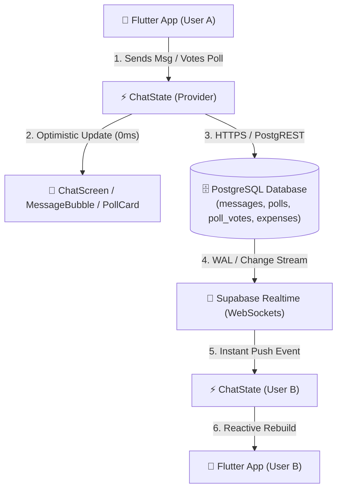
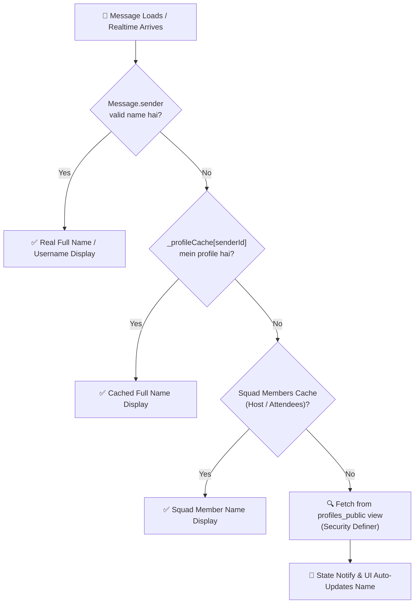
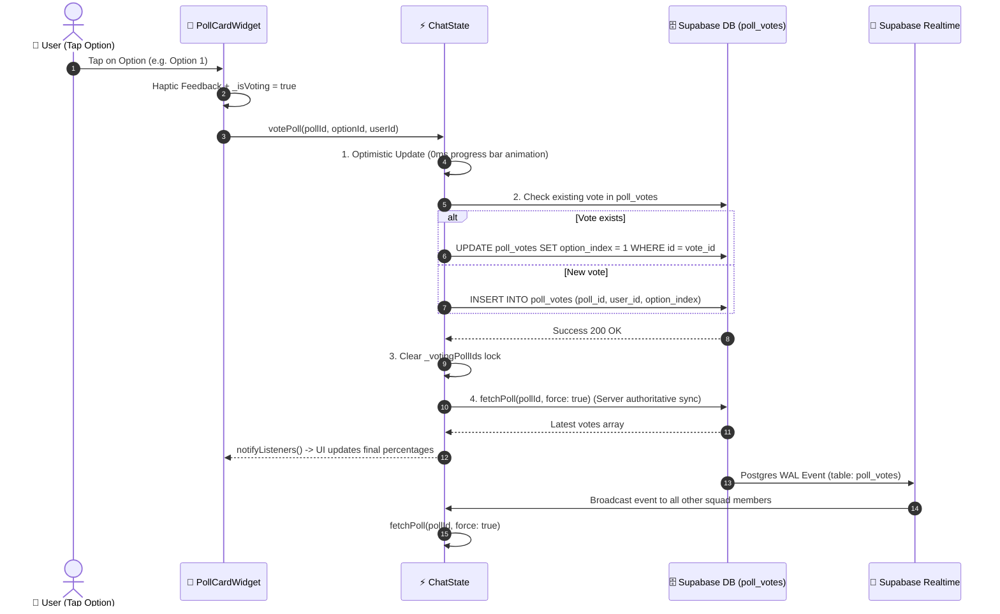
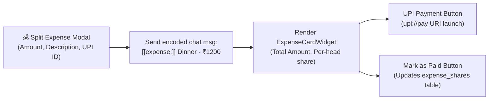

# tribeX Messaging System — Poori Architecture & Working Explanation (Hinglish Guide)

Yeh document tribeX ke **Realtime Messaging, Member Names, Group Polls aur Expense Splitting System** ko aasan aur crystal-clear Hinglish me explain karta hai, diagrams ke sath.

---

## 1. High-Level Architecture Overview (Ek Nazar Mein)

tribeX ka chat system sirf normal WhatsApp jaisa text chat nahi hai — yeh **Live Activity Squad Coordination Engine** hai. Isme:
1. **Regular Chat Messages** (Text, timestamp, sender identity)
2. **Interactive Group Polls** (`[[poll:<uuid>]]` cards with instant live voting)
3. **Split Expenses** (`[[expense:<uuid>]]` cards with UPI IDs & per-head calculation)
4. **System Events** (Squad join/leave, plan updates)
5. **Squad Memories** (Photos uploaded to Supabase Storage)

Sab kuch **Supabase Realtime WebSockets** ke zariye 100ms se kam time mein sync hota hai.



---

## 2. Sender Identity Fix: "Squad Member" ke badle Asli Naam Kaise Aata Hai?

### Pehle Kya Problem Thi? (Root Cause)
1. Supabase mein `public.profiles` table par security policy (RLS) lagi thi:
   ```sql
   CREATE POLICY "Users can view own profile" ON public.profiles FOR SELECT USING (auth.uid() = id);
   ```
2. Iska matlab: Har user **sirf apna profile row** direct select kar sakta tha. Jab User A doosre members ke messages fetch karta tha, to PostgREST unka `profiles` data **NULL** return kar deta tha.
3. Chat UI mein null check hone par fallback string `'Squad Member'` hardcoded dikhta tha.
4. New realtime messages aane par bhi server payload sirf raw `sender_id` bhejta tha, profile data nahi.

### Ab Humne Kaise Fix Kiya? (3-Layer Smart Identity Pipeline)



1. **`_profileCache` Memory Store:**
   - `ChatState` ke andar ek global in-memory profile cache `_profileCache` maintain kiya gaya hai.
2. **`profiles_public` Security-Definer View:**
   - Jab messages load hote hain, to unke sabhi sender IDs ko batch mein safe view `profiles_public` se ek single fast query mein fetch karke cache mein daal diya jata hai.
3. **`get_squad_members` RPC & Auto-fetch:**
   - Jaise hi user Chat Screen open karta hai, `ChatState.fetchSquadMembers(activityId)` background mein chal jaata hai. Yeh host aur sabhi accepted attendees ke real names aur avatars ko cache me load kar deta hai.
4. **`MessageBubbleWidget` Smart Fallback:**
   - Message bubble ab kabhi bhi `"Squad Member"` nahi bolta. Pehle `message.sender`, fir `_profileCache`, fir `squadMembers`, fir username, aur agar sab fail ho to clean `'Member'`.

---

## 3. Group Poll System Kaise Kaam Karta Hai?

Poll system complete single-choice interactive poll hai jo web (TanStack) aur Flutter app dono par bilkul same tarike se chalta hai.

### Poll Structure
- Poll Question and Options Supabase table `public.polls` me store hote hain:
  - `question`: TEXT
  - `options`: JSONB array `["Option 1", "Option 2"]`
- Votes `public.poll_votes` table me store hote hain:
  - `poll_id`: UUID
  - `user_id`: UUID
  - `option_index`: INT (0, 1, 2...)
  - `UNIQUE (poll_id, user_id)` (Constraint enforce karta hai ki 1 user ka 1 hi vote ho sake)

### Poll Message Encoding
Polls ko chat me render karne ke liye TanStack-compatible token use hota hai:
```text
[[poll:3fa85f64-5717-4562-b3fc-2c963f66afa6]] Weekend Match kahan khele?
```
Jab chat list render hoti hai, to `Message.pollId` regex match karta hai. Agar poll ID milta hai, to regular text bubble ke badle **`PollCardWidget`** render hota hai.

### Poll Voting Life Cycle (Diagram)



### Key Poll Fixes Jo Humne Kiye:
1. **User ID Normalization & Casing Bug Solved:** Pehle Supabase Auth session aur database se aane wale user UUIDs me case sensitivity (`ABC-123` vs `abc-123`) ki wajah se `userVotedOptionId` match nahi ho pata tha, jisse option tap karne par checkmark ya selection trigger nahi hota tha. Ab `PollOption.fromJson`, `Poll.fromJson`, `hasVoted`, `userVotedOptionId`, aur `ChatState` me sabhi user IDs ko `.trim().toLowerCase()` par normalize kiya gaya hai.
2. **Replication Delay / Stale Overwrite Protection:** Pehle tap karte hi `fetchPoll` turant call hota tha. Agar DB me replication delay ya lag hota tha, to server se aane wala purana data user ke naye optimistic vote ko turant screen se gayab (erase) kar deta tha. Ab `_userPollVotes` aur `_userPollVoteTimes` 15-second protective window maintain karte hain taaki server ka stale snapshot client ke active vote ko kabhi override na kar sake.
3. **Atomic Upsert & Fallback:** Web TanStack frontend (`services.ts`) ki tarah `poll_votes` table par `upsert` with `onConflict: 'poll_id,user_id'` implement kiya gaya hai. Isse duplicate key constraint violation khatam ho gaya.
4. **Instant Non-Blocking Tap Response:** Pehle `_isVoting` flag pure card ke taps ko block kar deta tha jisse multiple taps drop ho jaate the. Ab har tap par instant haptic feedback + 0ms local state update hota hai aur card kabhi freeze nahi hota.
5. **Vote Persistence & Switching:** User kisi bhi dusre option par tap karke apna vote smoothly change kar sakta hai. Percentage bar smooth `AnimatedFractionallySizedBox` se 250ms me animate hota hai.

---

## 4. Split Expense System (UPI & Bills)

Bill splitting system TanStack React frontend ke sath 100% interoperable hai.



- **Format:** `[[expense:<id>]] Description · ₹Total`
- **Tables:** `public.expenses` aur `public.expense_shares`
- **Features:**
  - Sabhi accepted squad members ke beech equal amount split hota hai.
  - Creator aur attendees UPI app (GPay/PhonePe/Paytm) direct button se launch kar sakte hain.
  - Paid/Unpaid status realtime checkbox toggle ke sath sync hota hai.

---

## 5. Security & Access Control (RLS Rules)

Koi bhi outsider chat messages, polls, ya expenses nahi dekh sakta. Supabase RLS enforces:

| Entity | RLS Policy Rule | Kaun Access Kar Sakta Hai? |
| :--- | :--- | :--- |
| **Messages** | `public.has_activity_access(activity_id, auth.uid())` | Sirf Activity Host aur **Accepted** Squad Members |
| **Polls** | `created_by = auth.uid() OR has_activity_access(...)` | Sirf Plan Members create aur view kar sakte hain |
| **Poll Votes** | `auth.uid() = user_id AND has_activity_access(...)` | Sirf Plan Members apna vote daal aur badal sakte hain |
| **Expenses** | `created_by = auth.uid() OR has_activity_access(...)` | Plan Members bill create aur view kar sakte hain |
| **Profiles** | `profiles_public` view (Security Definer) | Non-sensitive safe fields (name, username, avatar) across squad |

---

## 6. Summary Cheat Sheet

1. **Messages Sending:** Durable client UUID v4 ke sath optimistic send hota hai. Offline ya network error hone par retry banner dikhta hai.
2. **Member Identity:** Profile cache aur `get_squad_members` RPC se real full name render hota hai; fallback "Squad Member" hat chuka hai.
3. **Poll Voting:** Option index matching robust hai, direct atomic update hota hai, self-lock race condition resolved hai, aur Realtime auto-update on hai.
4. **State Management:** Flutter `Provider` pattern + `ChangeNotifier` (ChatState) poore app me single source of truth maintain karta hai.
