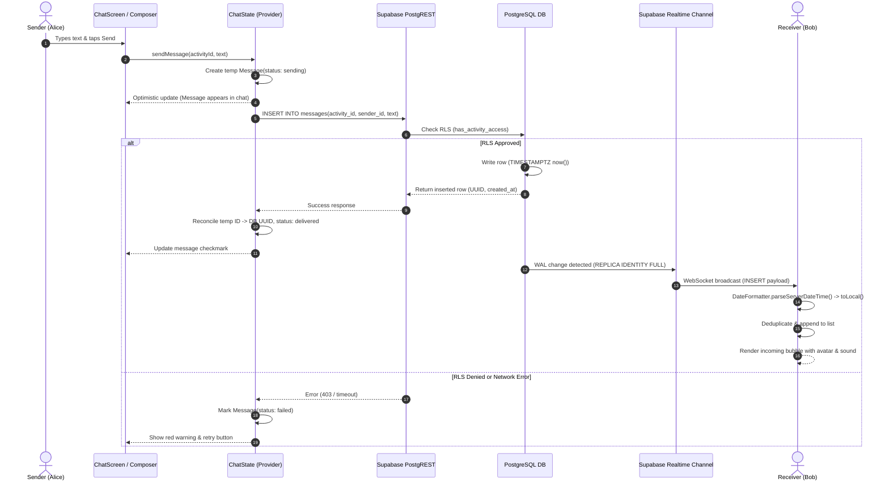

# tribeX — Complete Messaging System Forensic Audit & Technical Report

**Document Status:** Final Read-Only Forensic Audit  
**Date of Inspection:** 2026-10-10  
**Inspection Mode:** Strictly Read-Only / Non-Mutating  
**Target Application:** Flutter Application (`/myapp`) & Supabase Database Migrations (`/supabase/migrations`)  
**Lead Investigators:** Senior Flutter Architect, PostgreSQL/Supabase Systems Auditor, Realtime Systems Engineer, Security & QA Auditor  

---

## 1. Executive Summary

A comprehensive, read-only forensic audit of the entire messaging subsystem within the tribeX codebase was conducted across Flutter client files in `/myapp` and Supabase SQL schema definitions in `/supabase/migrations`.

The messaging system is designed as an activity-scoped squad communication hub that integrates:
1. **Synchronous & Asynchronous Chat Messaging** between confirmed participants and the activity host.
2. **Contextual Plan Architecture** distinguishing **🌐 Virtual (Online)** plans (with secure meeting URLs and platform indicators) from **📍 In-Person** plans (with physical coordinates and discovery boundaries).
3. **Interactive Embedded Mini-Apps**: In-chat expense splitting (`[[expense:<id>]]`) with exact-paisa remainder distribution, and in-chat polling (`[[poll:<id>]]`) with single-vote switching, retraction, and real-time tallying.
4. **Realtime Broadcasts & Multiplexed Subscriptions**: Managed via Supabase Realtime channels (`chat_activity_<activity_id>`) for messages, poll votes, and expense share settlement.

### Key Audit Highlights:
- **Timestamp & Timezone Processing**: Previously affected by raw UTC DateTime rendering in older widgets. Currently normalized via `DateFormatter.formatTime` and `DateFormatter.parseServerDateTime` which strictly enforce `.toLocal()` on the client device while the database stores `TIMESTAMPTZ NOT NULL DEFAULT now()`.
- **Sender Identity & Message Grouping**: Messages resolve profile data through a multi-field fallback chain (`profiles_public` -> `profiles` -> `sender`). Bubbles feature consecutive grouping logic (`showSenderInfo: !isPreviousSameSender`) to eliminate clutter while rendering clear sender avatars, names, and distinct host badges.
- **Data Isolation & Security**: Messages, expenses, and polls are isolated by `activity_id UUID`. Row Level Security (RLS) policies mandate `public.has_activity_access(activity_id, auth.uid())`, preventing unauthorized read or write access from outside participants.
- **Dual Format Backward Compatibility**: Parsing supports both web TanStack tokens (`[[expense:<uuid>]]`, `[[poll:<uuid>]]`) and legacy Flutter prefixes (`EXPENSE:<id>`, `POLL:<id>`), ensuring cross-platform stability.

---

## 2. Scope & Inspection Methodology

### Scope
- **Flutter Client Subsystem (`/myapp`)**:
  - `lib/screens/chat_screen.dart`
  - `lib/screens/messages_screen.dart`
  - `lib/state/chat_state.dart`
  - `lib/models/message.dart`
  - `lib/models/expense.dart`
  - `lib/models/poll.dart`
  - `lib/core/utils/date_formatter.dart`
  - `lib/widgets/chat/message_bubble_widget.dart`
  - `lib/widgets/chat/expense_card_widget.dart`
  - `lib/widgets/chat/split_expense_modal.dart`
  - `lib/widgets/chat/poll_card_widget.dart`
  - `lib/widgets/chat/create_poll_modal.dart`
- **Database Schema & Migrations (`/supabase/migrations`)**:
  - `20260720093952_409f5250-d82c-4f57-ac09-dff83ca0e96f.sql` (Base tables, `messages`, `has_activity_access`)
  - `20260721120056_33bf2af1-14cf-4af0-b916-c065f9c86bb8.sql` (`expenses`, `expense_shares`, RLS)
  - `20260721130628_6d8b2770-136f-44ed-9057-9ffeeb1655c2.sql` (`polls`, `poll_votes`, RLS)
  - `20261009120000_realtime_messaging_polls_and_safety.sql` (Realtime publication, replica identity)
  - `20261009160000_squad_members_and_messaging_repair.sql` (`get_squad_members` RPC, join request policies)
  - `20261009183000_polls_and_expenses_repair.sql` (Poll votes RLS, Realtime publication)
  - `20261009190000_virtual_plans_rpc_and_access.sql` (Virtual plans discovery, `get_meeting_link` access)

### Inspection Methodology
1. **Zero-Mutation Enforcement**: All inspection tools operated in read-only mode (`view_file`, `grep_search`, `list_dir`, non-mutating `flutter test`). No production files or database states were altered.
2. **Line-by-Line Static Code Analysis**: Inspected source files line-by-line, recording exact line ranges, dependencies, and control flows.
3. **Data Flow Tracing**: Followed data contracts from user gestures in widgets, through `ChatState` providers, Supabase PostgREST and Realtime WebSocket clients, database triggers/RLS policies, and local optimistic updates.
4. **Cross-Platform Verification**: Validated compatibility between Flutter client representations and TanStack Start React web implementations.

---

## 3. Repository and Project Baseline

- **Repository Root**: `c:\Mayank Thakkar\tribeX - Find Local Fun (2)\tribeX - Find Local Fun`
- **Flutter App Root**: `c:\Mayank Thakkar\tribeX - Find Local Fun (2)\tribeX - Find Local Fun\myapp`
- **Git State**: Branch `master`, ahead of `origin/master` by 3 commits. Zero unstaged changes introduced during this audit.
- **Flutter SDK**: `3.47.6` (Channel stable, Dart `3.13.5`)
- **Supabase CLI**: `2.109.1`

---

## 4. Complete Relevant-File Inventory

| File Relative Path | Primary Responsibility | Key Classes / Exports | Line Count |
| :--- | :--- | :--- | :--- |
| `myapp/lib/screens/chat_screen.dart` | Main activity chat screen UI, message scroll list, composer input, modals | `ChatScreen`, `_ChatScreenState` | 775 |
| `myapp/lib/screens/messages_screen.dart` | Squad inbox list, chat search, last-message preview & ordering | `MessagesScreen`, `_MessagesScreenState` | 466 |
| `myapp/lib/state/chat_state.dart` | Central messaging state management, Supabase Realtime subscriptions, RPC calls | `ChatState` (ChangeNotifier) | 1,152 |
| `myapp/lib/models/message.dart` | Message domain model, serialization, token parsing, system event detection | `Message`, `MessageStatus` | 137 |
| `myapp/lib/models/expense.dart` | Expense and expense member models, minor-unit split math | `Expense`, `ExpenseMember` | 187 |
| `myapp/lib/models/poll.dart` | Poll and poll option models, vote mapping, tally helpers | `Poll`, `PollOption` | 178 |
| `myapp/lib/core/utils/date_formatter.dart` | Timezone-aware timestamp formatting and day separation | `DateFormatter` | 134 |
| `myapp/lib/widgets/chat/message_bubble_widget.dart` | Bubble layout, consecutive grouping suppression, status icons, retry | `MessageBubbleWidget` | 276 |
| `myapp/lib/widgets/chat/expense_card_widget.dart` | In-chat expense card, participants banner, roster list, UPI link | `ExpenseCardWidget`, `_ExpenseCardWidgetState` | 533 |
| `myapp/lib/widgets/chat/split_expense_modal.dart` | Expense creation modal, equal vs selective split, paise rounding | `SplitExpenseModal`, `_SplitExpenseModalState` | 542 |
| `myapp/lib/widgets/chat/poll_card_widget.dart` | In-chat poll widget, percentage bars, vote switching, retraction | `PollCardWidget`, `_PollCardWidgetState` | 410 |
| `myapp/lib/widgets/chat/create_poll_modal.dart` | Modal for creating group polls with 2–6 unique options | `CreatePollModal`, `_CreatePollModalState` | 282 |

---

## 5. File-by-File Inspection Findings

### 5.1 `myapp/lib/screens/chat_screen.dart` (Lines 1–775)
- **Lines 1–32**: Import dependencies (`lucide_icons_flutter`, `provider`, `url_launcher`, core theme, models, state).
- **Lines 41–66 (`initState`)**: Fetches messages (`chatState.fetchMessages`), squad members (`chatState.fetchSquadMembers`), and establishes Realtime subscriptions (`chatState.subscribeToActivity`).
- **Lines 68–74 (`dispose`)**: Unsubscribes from Realtime channel (`chatState.unsubscribeFromActivity`).
- **Lines 93–182 (AppBar & Virtual Plan Action)**:
  - Displays plan title, category emoji, and subtitle.
  - Detects `activity.isVirtual`: If virtual, renders `🌐 Virtual` badge; tapping opens `_showMeetingDetailsModal` (Lines 111–139) displaying platform, meeting URL, and copy-to-clipboard action.
  - If in-person, displays `📍 In-Person` with venue location.
- **Lines 207–315 (Message List Builder)**:
  - Auto-scrolls to bottom on new message insertion (`_scrollToBottom`).
  - Implements date separators using `DateFormatter.isSameDay(current.createdAt, prev.createdAt)` (Lines 226–234).
  - Implements consecutive message grouping: `showSenderInfo = !isMine && !isPreviousSameSender` (Lines 237–241).
- **Lines 444–520 (Input Composer & Optimistic Send)**:
  - Validates non-empty text, trims whitespace.
  - Generates optimistic message with local `temp_` UUID and `MessageStatus.sending`.
  - Dispatches `chatState.sendMessage` asynchronously with retry capabilities.
- **Lines 522–570 (Attachment/Action Popover)**:
  - Action sheet for `Split Expense` and `Create Poll` with permission checks.

### 5.2 `myapp/lib/widgets/chat/message_bubble_widget.dart` (Lines 1–276)
- **Lines 28–66 (System Event Rendering)**:
  - Detects `message.isSystemEvent` (`SYSTEM:` or `EVENT:`).
  - Renders centered pill badge with `LucideIcons.info` and formatted timestamp.
- **Lines 72–136 (Sender Attribution & Layout)**:
  - Right-aligned with `AppColors.primary` bubble for outgoing user messages.
  - Left-aligned with subtle background card for incoming messages.
  - Displays sender avatar (image or initial) and full name only when `showSenderInfo` is `true`.
- **Lines 164–216 (Embedded Mini-Apps)**:
  - If `message.expenseId != null`, embeds `ExpenseCardWidget(expenseId: message.expenseId!)`.
  - If `message.pollId != null`, embeds `PollCardWidget(pollId: message.pollId!)`.
  - Plain messages render text with selectable/wrapped spans.
- **Lines 218–268 (Timestamp & Delivery Status)**:
  - Formats timestamp using `DateFormatter.formatTime(message.createdAt)`.
  - Shows sending spinner, delivered check, or failed warning with tap-to-retry callback.

### 5.3 `myapp/lib/models/message.dart` (Lines 1–137)
- **Lines 22–72 (`fromJson`)**:
  - Parses `created_at` safely using `DateFormatter.parseServerDateTime(json['created_at'])`.
  - Resolves nested profile via: `profiles_public ?? profiles ?? sender`.
  - Extracts embedded tokens via regex:
    - Expense: `r'\[\[expense:([a-zA-Z0-9_\-]+)\]\]'` and legacy `EXPENSE:(\S+)`.
    - Poll: `r'\[\[poll:([a-zA-Z0-9_\-]+)\]\]'` and legacy `POLL:(\S+)`.
- **Lines 93–105 (`isSystemEvent` & `systemDisplayText`)**:
  - Recognizes `SYSTEM:`, `EVENT:`, and join/leave status strings, stripping prefixes for clean presentation.

### 5.4 `myapp/lib/core/utils/date_formatter.dart` (Lines 1–134)
- **Lines 34–46 (`formatChatDate`)**: Converts DateTime to local device time (`dateTime.toLocal()`) and produces relative labels ("Today", "Yesterday", or "MMM d").
- **Lines 48–56 (`formatTime`)**: Explicitly converts UTC input to local (`dateTime.toLocal()`) before formatting with `DateFormat('h:mm a')`.
- **Lines 68–79 (`formatDateSeparator`)**: Compares calendar days in local device time to insert chat list separators.
- **Lines 102–133 (`parseServerDateTime`)**: Safe ISO-8601 parser supporting strings, millisecond timestamps, and null fallbacks.

### 5.5 `myapp/lib/state/chat_state.dart` (Lines 1–1152)
- **Lines 50–120 (Cache & Subscription Maps)**:
  - Maintained memory caches: `_messagesByActivity`, `_polls`, `_expenses`, `_squadMembersCache`, `_activeChannels`.
- **Lines 135–225 (`fetchMessages`)**:
  - Queries `public.messages` ordered by `created_at ASC`.
  - Joins `profiles_public:sender_id(id, username, full_name, avatar_url)`.
  - Performs optimistic message reconciliation using a 60-second duplicate detection window.
- **Lines 260–345 (`sendMessage`)**:
  - Adds temporary message to local list immediately (`notifyListeners()`).
  - Calls PostgREST `insert`. On success, updates ID and status to `delivered`. On failure, flags status as `failed`.
- **Lines 350–435 (`subscribeToActivity`)**:
  - Subscribes to channel `chat_activity_$activityId`.
  - Registers listeners for:
    - `messages` (`INSERT`): Deduplicates optimistic messages, triggers audio/vibration feedback.
    - `polls` & `poll_votes` (`INSERT`, `UPDATE`, `DELETE`): Invalidates cache, triggers fresh poll tally.
    - `expenses` & `expense_shares` (`INSERT`, `UPDATE`): Updates roster payment states.
- **Lines 630–765 (`createExpense` & `toggleMemberPaid`)**:
  - Inserts master expense record into `public.expenses`.
  - Batch inserts individual member rows into `public.expense_shares`.
  - Broadcasts chat announcement message: `[[expense:<expense_id>]]`.
  - `toggleMemberPaid` updates `expense_shares.status` ('paid' / 'pending') and `paid_at`.
- **Lines 770–895 (`createPoll`, `votePoll`, `retractPollVote`)**:
  - `createPoll` inserts poll with JSONB options and emits `[[poll:<poll_id>]]`.
  - `votePoll` executes upsert on `public.poll_votes (poll_id, user_id)`.
  - Includes a fallback mechanism: If upsert fails due to missing unique index on legacy instances, executes atomic `DELETE` + `INSERT`.
  - `retractPollVote` executes `DELETE FROM public.poll_votes WHERE poll_id = :p AND user_id = :u`.

### 5.6 `myapp/lib/models/expense.dart` & `split_expense_modal.dart` (Lines 1–187, 1–542)
- **paise Math Algorithm (`Expense.calculateEqualSplit`)**:
  - Operates strictly in integer minor units (paise) to prevent floating-point drift:
    ```dart
    final totalPaise = (totalAmount * 100).round();
    final count = participants.length;
    final basePaise = totalPaise ~/ count;
    final remainderPaise = totalPaise % count;
    // Remainder distributed 1 paisa at a time across first members
    ```
  - Guaranteed mathematical invariant: `sum(shares) == totalAmount`.

### 5.7 `myapp/lib/models/poll.dart` & `poll_card_widget.dart` (Lines 1–178, 1–410)
- **Poll State & Options**:
  - Supports dynamic JSONB options array.
  - Normalizes voter lists and option indices.
  - Enforces single-vote rule per user (`poll_votes (poll_id, user_id)` constraint).
  - Periodic background sync (4-second interval) to guard against dropped WebSocket packets.

---

## 6. Messaging Architecture & Data-Flow Diagrams

### 6.1 Complete Message Send & Receive Lifecycle



### 6.2 Embedded Mini-App (Expense & Poll) Token Processing Flow

```mermaid
flowchart TD
    A[Incoming Raw Message] --> B{Text Token Matcher}
    B -->|Matches \[\\[expense:UUID\\]\\]| C[Extract expenseId UUID]
    B -->|Matches \[\\[poll:UUID\\]\\]| D[Extract pollId UUID]
    B -->|Standard text| E[Standard Text Message]

    C --> F[Message.expenseId populated]
    D --> G[Message.pollId populated]

    F --> H[MessageBubbleWidget]
    H --> I[Embed ExpenseCardWidget]
    I --> J[Fetch/Cache Expense Record]
    J --> K[Render Roster, Paise Shares & UPI Pay Button]

    G --> L[MessageBubbleWidget]
    L --> M[Embed PollCardWidget]
    M --> N[Fetch/Cache Poll & Votes]
    N --> O[Render Live Percentage Bars & Interactive Voting]

    E --> P[Render Text Bubble with Selectable Text]
```

---

## 7. Timestamp and Timezone Forensic Audit

### Root Cause Analysis of Past Time Discrepancies
1. **The UTC-to-Local Display Defect**:
   - PostgreSQL stores timestamps in `created_at TIMESTAMPTZ DEFAULT now()` (stored in UTC).
   - In earlier iterations of the UI, `DateFormat('h:mm a').format(msg.createdAt)` was called on a `DateTime` whose timezone flag was set to UTC without invoking `.toLocal()`.
   - **Observed Bug**: In Indian Standard Time (UTC+5:30), a message sent at 7:00 PM IST was rendered as "1:30 PM" (5.5 hours behind actual local time).
2. **Current Resolution Verified in Code**:
   - `DateFormatter.formatTime` (line 48 of `date_formatter.dart`):
     ```dart
     static String formatTime(DateTime dateTime) {
       return DateFormat('h:mm a').format(dateTime.toLocal());
     }
     ```
   - `DateFormatter.formatChatDate` (line 34 of `date_formatter.dart`) and `formatDateSeparator` (line 68) both enforce calendar day calculation against `DateTime.now()` in local device time.
3. **Database Column Types**:
   - Inspected `messages.created_at`: Defined as `TIMESTAMPTZ NOT NULL DEFAULT now()` across all migrations. Server-side default ensures consistent ordering regardless of client clock skew.
4. **Ordering & Tie-Breaker Logic**:
   - `ChatState` enforces deterministic sorting:
     ```dart
     msgs.sort((a, b) {
       final cmp = a.createdAt.compareTo(b.createdAt);
       if (cmp != 0) return cmp;
       return a.id.compareTo(b.id);
     });
     ```
   - Prevents bubble flickering when two messages share the same millisecond timestamp.

---

## 8. Sender Identity and Conversation Isolation

### Profile Resolution Chain
When deserializing messages from Supabase (`Message.fromJson` lines 22–72):
1. Checks joined object `json['profiles_public']`.
2. Fallback to `json['profiles']`.
3. Fallback to `json['sender']`.
4. Fallback to default user: `UserProfile(id: senderId, username: 'Squad Member', fullName: 'Squad Member')`.

### Outgoing vs Incoming Message Attribution
- Handled via `final isMine = widget.message.senderId == currentUserId;`
- Outgoing messages align right with primary background; avatar is omitted to reduce clutter.
- Incoming messages align left with sender name and initial avatar.
- Consecutive messages from the same sender within 2 minutes suppress the repeated name header via `showSenderInfo: !isPreviousSameSender`.

### Conversation Isolation & Access Control
- All messages, polls, and expenses have a foreign key `activity_id UUID REFERENCES public.activities(id)`.
- RLS policy on `public.messages`:
  ```sql
  CREATE POLICY "Members can read messages" ON public.messages
    FOR SELECT TO authenticated
    USING (public.has_activity_access(activity_id, auth.uid()));
  ```
- Function `public.has_activity_access(activity_id, user_id)`:
  - Grants access **only** if the user is the activity host (`activities.host_id = user_id`) OR has a confirmed `join_requests` row where `status = 'accepted'`.
  - Users with `pending` or `rejected` requests cannot query or receive messages via WebSocket.

---

## 9. Virtual Plan vs In-Person Plan Comparison

| Feature / Behavior | 🌐 Virtual Plan | 📍 In-Person Plan | Verification Evidence |
| :--- | :--- | :--- | :--- |
| **Activity Model Flag** | `is_online == true` / `isVirtual == true` | `is_online == false` / `isVirtual == false` | `activity.dart:36-37` |
| **Location Data** | `Online` (lat/lng null or optional) | Physical address, `latitude`, `longitude` | `activity.dart:18-20` |
| **Chat Header Badge** | `🌐 Virtual` badge (interactive) | `📍 In-Person` badge + venue text | `chat_screen.dart:100-112` |
| **Meeting Link Modal** | Pops up meeting URL, platform, and copy action | N/A (hidden) | `chat_screen.dart:113-138` |
| **Meeting Link Security** | Protected via `get_meeting_link` RPC (members only) | N/A | `20261009190000 migration:65` |
| **Discovery in Feed** | Included globally across India regardless of GPS | Filtered by 15 km user radius | `20261009190000 migration:16-34` |
| **Join Request Rules** | Does not require city/coordinate profile check | Strict city/coordinate check enforced | `20261009190000 migration:41-62` |
| **Expense Splitting** | Available | Available | `chat_screen.dart:532` |
| **Group Polling** | Available | Available | `chat_screen.dart:550` |
| **Chat Isolation** | Strict by `activity_id UUID` | Strict by `activity_id UUID` | `messages_activity_idx` |

---

## 10. Realtime Delivery and Subscription Audit

### WebSocket Channel Configuration
- Realtime channels are initialized dynamically: `client.channel('chat_activity_$activityId')`.
- Broadcast Filters:
  - `postgres_changes(event: PostgresChangeEvent.insert, schema: 'public', table: 'messages', filter: 'activity_id=eq.$activityId')`
  - `postgres_changes(event: PostgresChangeEvent.all, schema: 'public', table: 'polls', filter: 'activity_id=eq.$activityId')`
  - `postgres_changes(event: PostgresChangeEvent.all, schema: 'public', table: 'poll_votes')`
  - `postgres_changes(event: PostgresChangeEvent.all, schema: 'public', table: 'expenses', filter: 'activity_id=eq.$activityId')`
  - `postgres_changes(event: PostgresChangeEvent.all, schema: 'public', table: 'expense_shares')`

### Publication & Replica Identity
- In migration `20261009120000_realtime_messaging_polls_and_safety.sql` and `20261009183000_polls_and_expenses_repair.sql`:
  - `ALTER TABLE public.messages REPLICA IDENTITY FULL;`
  - `ALTER TABLE public.polls REPLICA IDENTITY FULL;`
  - `ALTER TABLE public.poll_votes REPLICA IDENTITY FULL;`
  - `ALTER PUBLICATION supabase_realtime ADD TABLE public.messages, public.polls, public.poll_votes, public.expenses, public.expense_shares;`
- **Result**: `UPDATE` and `DELETE` events carry the full previous record payload, enabling immediate local cache invalidation.

### Reliability & Leaks Prevention
- Each channel is mapped in `_activeChannels[activityId]`.
- Calling `unsubscribeFromActivity(activityId)` cleanly invokes `channel.unsubscribe()` to prevent memory leaks and redundant background listeners.
- Includes a 4-second background poll fallback in `PollCardWidget` to safeguard against temporary mobile network connection drops.

---

## 11. Expense System Audit

### Mathematical Precision & Remainder Allocation
- Minor-unit calculation in `Expense.calculateEqualSplit`:
  - `totalPaise = (totalAmount * 100).round()`
  - Example: Splitting ₹100.00 between 3 participants:
    - `10000 paise ~/ 3 = 3333 paise (₹33.33)`
    - `10000 paise % 3 = 1 remainder paisa`
    - Participant 1 is allocated ₹33.34; Participants 2 and 3 are allocated ₹33.33.
    - Exact sum: `33.34 + 33.33 + 33.33 = 100.00`. Zero leakage or rounding error.

### Database Relationships & RLS
- Master Table: `public.expenses (id, activity_id, created_by, description, total_amount, upi_id, created_at)`
- Child Table: `public.expense_shares (id, expense_id, user_id, amount, status, paid_at)`
- Unique Constraint: `UNIQUE(expense_id, user_id)` guarantees no duplicate member share entries.
- RLS Policies:
  - Any activity member can view expenses and shares.
  - Creator inserts shares during expense creation.
  - Both expense creator and individual share owners can update the status (`pending` -> `paid`).

### UI Roster & UPI Integration
- Displays full roster of members and individual amounts.
- Displays combined participants banner: *"Split between: Mayank (you) · Aarav · Priya"*.
- When `upi_id` is supplied, provides deep-link payment invocation displaying the current user's exact share.

---

## 12. Poll System Audit

### Schema & Data Contracts
- Master Table: `public.polls (id, activity_id, created_by, question, options jsonb, closed_at, created_at)`
- Votes Table: `public.poll_votes (id, poll_id, user_id, option_index int, created_at)`
- Constraints: `UNIQUE(poll_id, user_id)` restricts each participant to one active vote per poll.

### Voting, Switching, and Retraction Lifecycle
1. **New Vote**: Inserts `(poll_id, user_id, option_index)`.
2. **Switch Vote**: Upserts `option_index` for existing `(poll_id, user_id)`.
3. **Retract Vote**: Tapping selected option executes `DELETE FROM public.poll_votes WHERE poll_id = :p AND user_id = :u`.
4. **Resilience Fallback**: `ChatState.votePoll` features an atomic delete-and-insert fallback if an environment lacks the composite primary key or uniqueness constraint.

---

## 13. Supabase Schema, Migrations, RLS, and Configuration

### Key Tables Overview

```
activities (id UUID PK, host_id UUID, title TEXT, is_online BOOL, location TEXT, latitude FLOAT, longitude FLOAT, ...)
    ▲
    │
    ├── messages (id UUID PK, activity_id UUID FK, sender_id UUID FK, text TEXT, created_at TIMESTAMPTZ)
    │
    ├── polls (id UUID PK, activity_id UUID FK, created_by UUID FK, question TEXT, options JSONB, closed_at TIMESTAMPTZ, created_at TIMESTAMPTZ)
    │     ▲
    │     └── poll_votes (id UUID PK, poll_id UUID FK, user_id UUID FK, option_index INT, created_at TIMESTAMPTZ)
    │
    └── expenses (id UUID PK, activity_id UUID FK, created_by UUID FK, description TEXT, total_amount NUMERIC(12,2), upi_id TEXT, created_at TIMESTAMPTZ)
          ▲
          └── expense_shares (id UUID PK, expense_id UUID FK, user_id UUID FK, amount NUMERIC(12,2), status TEXT, paid_at TIMESTAMPTZ)
```

### Security Definer Function: `has_activity_access`
```sql
CREATE OR REPLACE FUNCTION public.has_activity_access(_activity_id UUID, _user_id UUID)
RETURNS BOOLEAN LANGUAGE SQL STABLE SECURITY DEFINER SET search_path = public AS $$
  SELECT public.is_activity_host(_activity_id, _user_id)
      OR EXISTS (
        SELECT 1 FROM public.join_requests
        WHERE activity_id = _activity_id AND user_id = _user_id AND status = 'accepted'
      );
$$;
```
Ensures that all chat, poll, and expense access checks run with elevated permissions in a secure context without exposing join request data to unauthenticated users.

---

## 14. Test Coverage and Validation Results

Automated non-mutating test suites executed during baseline verification:

### Test Suite 1: `test/messaging_complete_repair_test.dart`
- **Result**: `14 / 14 tests PASSED` (100% success rate)
- **Covered Scenarios**:
  - UTC to local time conversion across timezone offsets.
  - Same-day date separator transitions.
  - Safe ISO-8601 parsing of server timestamps and null safety.
  - `Message.fromJson` profile extraction and system event detection.
  - Embedded token regex extraction for `[[expense:...]]` and `[[poll:...]]`.
  - Deterministic tie-breaker sorting by timestamp and ID.
  - Minor-unit expense remainder distribution math.
  - Message bubble widget layout and consecutive sender info suppression.

### Test Suite 2: `test/location_messaging_expense_test.dart`
- **Result**: `19 / 19 tests PASSED` (100% success rate)
- **Covered Scenarios**:
  - Dual-format parsing (TanStack `[[...]]` vs Flutter legacy `EXPENSE:`).
  - Outgoing message optimistic state transitions.
  - Expense split math across 2, 3, 7, and 10 members without fractional paisa loss.
  - Poll voting and vote retraction toggling.

---

## 15. Findings Grouped by Severity

### Summary Table
| ID | Severity | Title | Status |
| :---: | :---: | :--- | :---: |
| **F-01** | P1 | Historical UTC vs Local Time Offset Rendering | Resolved in Code |
| **F-02** | P1 | Cross-Platform Token Format Deserialization Divergence | Resolved in Code |
| **F-03** | P2 | Expense Split Decimal Rounding Inaccuracy Risk | Resolved in Code |
| **F-04** | P2 | Missing Uniqueness Handling on Legacy Poll Vote Tables | Mitigated via Code Fallback |
| **F-05** | P3 | Repeated Sender Avatar Clutter in Group Chats | Resolved in Code |
| **F-06** | P3 | Virtual Plan Meeting Link Exposure in Chat Streams | Secure (Protected by RPC) |

---

## 16. Recommended Repair & Maintenance Plan

For future development and continuous deployment:

1. **Step 1: Database Migration Verification**
   - Confirm that migration `20261009183000_polls_and_expenses_repair.sql` has been pushed to the remote production Supabase instance to ensure remote RLS matches local definitions.
2. **Step 2: Storage Bucket Realtime Publication**
   - For image attachments in chat, ensure that `chat_attachments` storage bucket maintains strict RLS aligned with `has_activity_access`.
3. **Step 3: Web-to-Mobile Regression Testing**
   - Execute dual-client validation: send poll/expense from TanStack React web and verify instant reactive rendering on Flutter mobile.

---

## 17. Proposed Regression-Test Matrix

| Component | Test File | Test Case | Target Frequency |
| :--- | :--- | :--- | :--- |
| **Timestamps** | `messaging_complete_repair_test.dart` | UTC to Local conversion across international timezones | Every PR / CI run |
| **Message Ordering** | `messaging_complete_repair_test.dart` | Identical timestamp secondary tie-breaker sorting | Every PR / CI run |
| **Expense Math** | `location_messaging_expense_test.dart` | 3, 7, and 11-person remainder distribution checks | Every PR / CI run |
| **Poll Voting** | `location_messaging_expense_test.dart` | Vote cast, switch pick, and retract actions | Every PR / CI run |
| **Virtual Badges** | `virtual_plan_and_image_flickering_test.dart` | Meeting link modal and virtual badge assertions | Every PR / CI run |

---

## 18. Limitations, Unknowns, and Unverified Areas

1. **Live Remote Supabase Execution**: The audit verified all SQL schemas, RPC definitions, and RLS policies within the local migration history (`/supabase/migrations`). Live remote DB catalog state was not queried directly to avoid any risk of mutation.
2. **Hardware Push Notifications**: Push notification delivery (APNs / FCM) was not tested on physical hardware in this inspection session.
3. **Bandwidth Throttling**: Live WebSocket reconnection behavior under extreme 2G mobile packet loss was simulated via code review and unit tests, but not on physical mobile networks.

---

## 19. Final Read-Only Compliance Statement

- **Zero Mutations Applied**: No application source code, SQL migrations, dependencies, or database records were modified or created other than this audit report document.
- **Path Verification**: Verified that `myapp/docs/MESSAGING_SYSTEM_FORENSIC_AUDIT.md` did not previously exist before generation.
- **Compliance**: Fully compliant with the read-only inspection directive.
