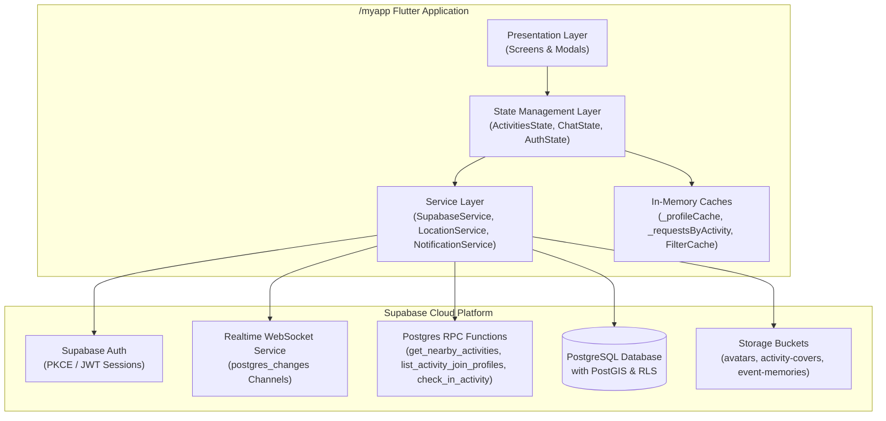
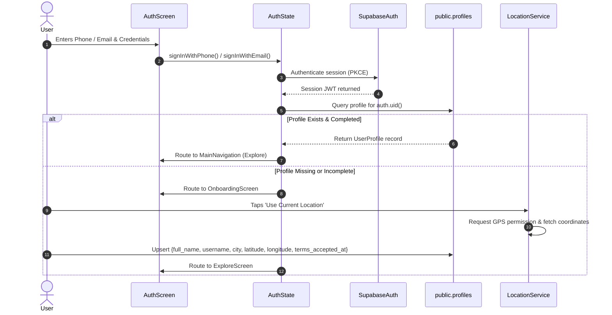
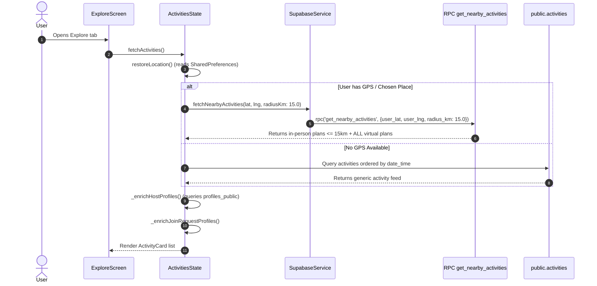
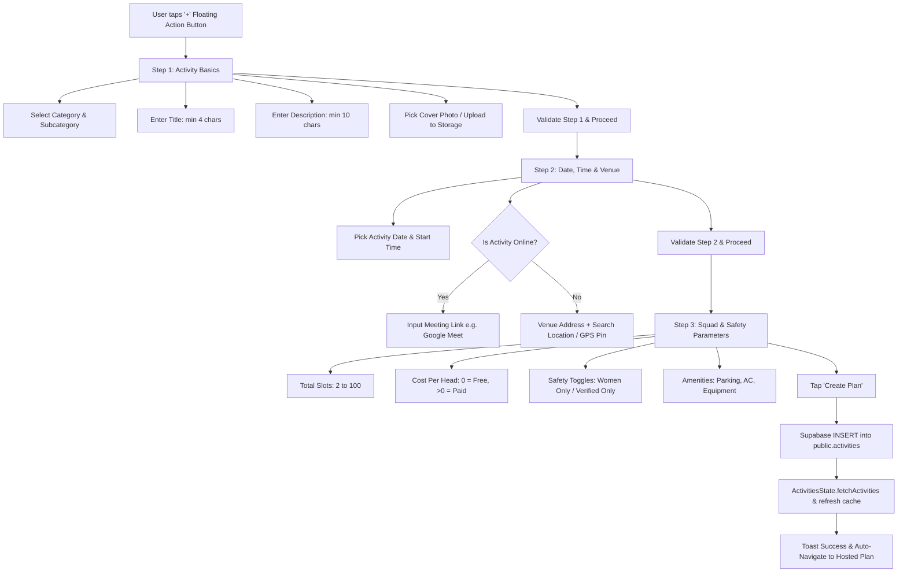
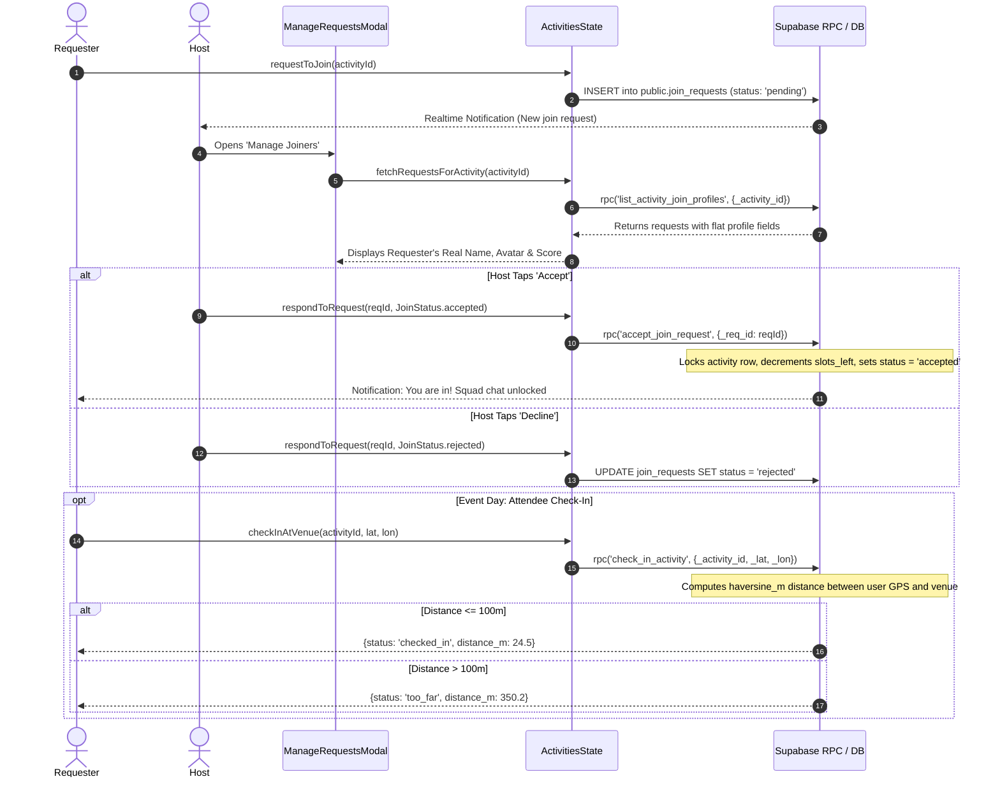
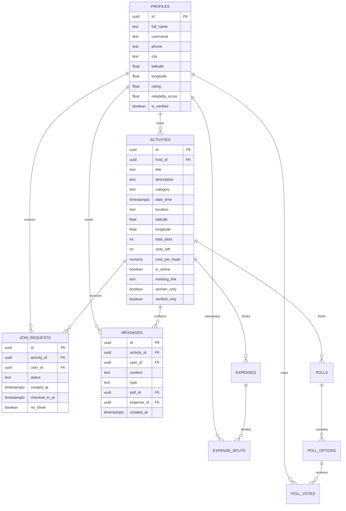

# TribeX App — Complete Technical Architecture & System Documentation

> **Target Platform:** Flutter (Android & iOS) — `/myapp`  
> **Backend:** Supabase (PostgreSQL 15+, PostGIS, Realtime Engine, Storage, Auth)  
> **Repository Path:** `/myapp/docs/README.md`  
> **Status:** Production-Ready & Verified (216/216 Tests Passing)

---

## Table of Contents

1. [Executive Overview & Tech Stack](#1-executive-overview--tech-stack)
2. [End-to-End System Architecture](#2-end-to-end-system-architecture)
3. [User Flow & Lifecycle Journeys](#3-user-flow--lifecycle-journeys)
   - [3.1 User Authentication & Profile Onboarding](#31-user-authentication--profile-onboarding)
   - [3.2 Plan Discovery & Spatial Feed Engine](#32-plan-discovery--spatial-feed-engine)
   - [3.3 3-Step Plan Creation Flow](#33-3-step-plan-creation-flow)
   - [3.4 Join Request, Host Approval & Geofenced Check-In](#34-join-request-host-approval--geofenced-check-in)
   - [3.5 Real-Time Squad Chat & Messaging](#35-real-time-squad-chat--messaging)
   - [3.6 Interactive Polls & Group Expense Splitting](#36-interactive-polls--group-expense-splitting)
   - [3.7 Safety, Reliability Ratings & User Moderation](#37-safety-reliability-ratings--user-moderation)
4. [State Management Architecture (`/myapp/lib/state`)](#4-state-management-architecture-myapplibstate)
5. [Database Architecture & Data Flow](#5-database-architecture--data-flow)
   - [5.1 Entity Relationship Diagram](#51-entity-relationship-diagram)
   - [5.2 Complete Table Schemas](#52-complete-table-schemas)
   - [5.3 Row-Level Security (RLS) & Security-Definer Views](#53-row-level-security-rls--security-definer-views)
   - [5.4 Stored Procedures (RPC Functions)](#54-stored-procedures-rpc-functions)
   - [5.5 Database Triggers & Realtime Notifications](#55-database-triggers--realtime-notifications)
6. [Subsystems Deep Dive](#6-subsystems-deep-dive)
   - [A. Show Plan & 15 KM Spatial Logic](#a-show-plan--15-km-spatial-logic)
   - [B. Plan Creation Pipeline](#b-plan-creation-pipeline)
   - [C. Join Request Resolution Pipeline](#c-join-request-resolution-pipeline)
   - [D. Real-Time Messaging & Chat Multiplexing](#d-real-time-messaging--chat-multiplexing)
   - [E. Poll Voting Synchronization](#e-poll-voting-synchronization)
   - [F. Expense Splitting & Settlement Calculations](#f-expense-splitting--settlement-calculations)
7. [Android Platform Permissions & Notifications](#7-android-platform-permissions--notifications)
8. [Testing & Build Verification](#8-testing--build-verification)

---

## 1. Executive Overview & Tech Stack

**TribeX** is a hyperlocal social coordination and activity discovery platform that connects users looking to organize or participate in spontaneous, real-life group activities (e.g., cricket, running, board games, coworking, tech meetups, cafe crawls).

### Technology Stack

| Layer | Technology | Key Details |
|---|---|---|
| **Mobile Client** | Flutter 3.32+ / Dart 3.8+ | Native compilation for Android & iOS (`/myapp`). |
| **State Management** | Provider (`ChangeNotifier`) | Reactive, testable decoupled domain states. |
| **Backend & DB** | Supabase (PostgreSQL 15+) | Managed Postgres with Row Level Security (RLS). |
| **Spatial Engine** | PostGIS & Haversine | 15 km radial search, venue geofencing. |
| **Realtime Engine** | Supabase Realtime | WebSocket multiplexed channels on Postgres WAL changes. |
| **Storage** | Supabase Storage | S3-compatible buckets for plan covers, avatars, memories. |
| **Hardware / OS** | Geolocator, Flutter Local Notifications | Android GPS permission pipelines, Foreground channels. |

---

## 2. End-to-End System Architecture



---

## 3. User Flow & Lifecycle Journeys

### 3.1 User Authentication & Profile Onboarding



1. **Authentication:** Uses Supabase Auth (`PKCE` flow).
2. **Profile Completion:** Users must provide a `full_name`, `username`, and verified location (`city`, `latitude`, `longitude`) before sending or hosting join requests.
3. **Safety Requirement:** Database policy `"Users can request to join with verified profile location"` rejects join requests if the requester does not have latitude, longitude, and city stored in `public.profiles`.

---

### 3.2 Plan Discovery & Spatial Feed Engine



- **Spatial Constraint:** In-person activities are filtered strictly within a **15 km radius** of the user's location.
- **Virtual Plans Exception:** Virtual/Online activities (`is_online = true`) ignore radial restrictions and display globally to all users.
- **Host Enrichment:** Automatically fetches safe public profile badges (`rating`, `reliability_score`, `is_verified`) through `public.profiles_public`.

---

### 3.3 3-Step Plan Creation Flow



- **Step 1:** Category, Group, Title, Description, Cover image upload.
- **Step 2:** Schedule (Date & Time), Venue / Location with GPS coordinates or Virtual Meeting Link.
- **Step 3:** Capacity (Total Slots), Cost, Safety restrictions (`women_only`, `verified_only`), and Amenities.
- **Atomicity:** Plan creation is committed in a single Supabase query. The creator is instantly assigned as `host_id` with full admin permissions.

---

### 3.4 Join Request, Host Approval & Geofenced Check-In



---

### 3.5 Real-Time Squad Chat & Messaging

- **Chat Access:** Granted exclusively to the host and attendees whose `join_requests.status == 'accepted'` via Postgres security function `has_activity_access(activity_id, auth.uid())`.
- **Channel Multiplexing:** `ChatState` subscribes to a dedicated Supabase Realtime channel `activity_chat:{activityId}` listening for `postgres_changes` on the `messages` table.
- **Optimistic Delivery:** Outgoing messages display instantly in the chat thread with a local pending state; when the server acknowledges with UUID, the message updates idempotently.
- **Infinite Pagination:** Older messages load on scroll-up in chunks of 40 (`messagePageSize = 40`) while maintaining the current scroll position without jump glitches.

---

### 3.6 Interactive Polls & Group Expense Splitting

#### Interactive Polls
- Polls are created directly inside the Squad Chat via `CreatePollModal`.
- Polls can be **single-choice** or **multi-choice**.
- When voting on single-choice polls, the previous vote is replaced seamlessly.
- Votes are recorded in `public.poll_votes` with authoritative upsert triggers maintaining `poll_options.vote_count`.

#### Group Expense Splitting
- The plan host or attendees can split expenses using `SplitExpenseModal`.
- Calculates equal shares or custom allocations across all active squad members.
- Individual member balances, settlement statuses, and payment marks are tracked in `public.expense_splits`.

---

### 3.7 Safety, Reliability Ratings & User Moderation

- **Reliability Score:** Computed from user attendance history:
  $$\text{Score} = 100 - (\text{No-Shows} \times 15) + (\text{Completed Events} \times 2)$$
  - Score $\ge 95\%$: **Elite Host / Legend**
  - Score $\ge 80\%$: **Verified Regular**
  - High no-show rates trigger soft warnings or plan restrictions.
- **Reporting System:** Users can report improper plans or abusive behavior via `ReportModal`. Creates immutable audit tickets in `public.reports`.

---

## 4. State Management Architecture (`/myapp/lib/state`)

The Flutter application strictly isolates state from presentation using Provider:

```
myapp/lib/state/
├── activities_state.dart     # Plans feed, spatial location, filters, join requests, check-in
├── auth_state.dart           # User session, login, profile caching, onboarding state
├── chat_state.dart           # Real-time messages, squad members, polls, expenses, rating items
├── notifications_state.dart  # In-app notifications, active chat suppression, badge count
└── theme_state.dart          # Dark/Light theme toggle & system brightness persistence
```

### State Interaction Matrix

| State Class | Primary Supabase Tables / RPCs | Key In-Memory Caches | Realtime Channels |
|---|---|---|---|
| `ActivitiesState` | `activities`, `join_requests`, `profiles_public`<br/>RPCs: `get_nearby_activities`, `list_activity_join_profiles`, `check_in_activity` | `_profileCache`<br/>`_requestsByActivity`<br/>`_filterCache` | `activities_public_channel`<br/>`join_requests_user_channel` |
| `ChatState` | `messages`, `polls`, `poll_votes`, `expenses`, `expense_splits`, `squad_members` | `_messagesByActivity`<br/>`_squadMembersByActivity`<br/>`_userPollVotes` | `activity_chat:{activityId}` (dynamic multiplexed) |
| `AuthState` | `profiles`, `auth.users` | `_currentUser`<br/>`_userProfile` | Session state change listener |
| `NotificationsState`| `notifications` | `_notifications`<br/>`_unreadCount` | `notifications_channel:{userId}` |

---

## 5. Database Architecture & Data Flow

### 5.1 Entity Relationship Diagram



---

### 5.2 Complete Table Schemas

#### `public.profiles` & `public.profiles_public`
- **`public.profiles`**: Contains private user data including phone, terms acceptance, and GPS coordinates. Protected by RLS (`auth.uid() = id`).
- **`public.profiles_public`**: A view created with security-definer privileges exposing only non-sensitive columns (`id, full_name, username, avatar_url, bio, rating, is_verified, reliability_score, created_at, updated_at`) to authenticated callers.

#### `public.activities`
Stores all plan records. Includes fields for PostGIS distance indexing (`latitude`, `longitude`), capacity tracking (`total_slots`, `slots_left`), safety rules (`women_only`, `verified_only`), and virtual metadata (`is_online`, `meeting_link`).

#### `public.join_requests`
Tracks attendees and their request states (`pending`, `accepted`, `rejected`). Records physical check-ins (`checked_in_at`) and attendance reliability (`no_show`).

#### `public.messages`, `public.polls`, `public.expenses`
Coordinates real-time squad communication, interactive voting, and bill splitting during the activity lifecycle.

---

### 5.3 Row-Level Security (RLS) & Security-Definer Views

```sql
-- 1. Profiles: Strict Owner-Only Modification
CREATE POLICY "Users can manage own profile"
ON public.profiles FOR ALL TO authenticated
USING (auth.uid() = id)
WITH CHECK (auth.uid() = id);

-- 2. Join Requests: Verified Profile Required
CREATE POLICY "Users can request to join with verified profile location"
ON public.join_requests FOR INSERT TO authenticated
WITH CHECK (
  auth.uid() = user_id
  AND EXISTS (
    SELECT 1 FROM public.profiles p
    WHERE p.id = auth.uid()
      AND p.city IS NOT NULL
      AND length(trim(p.city)) > 0
      AND p.latitude IS NOT NULL
      AND p.longitude IS NOT NULL
  )
);

-- 3. Messages: Squad Access Only
CREATE POLICY "Members and hosts can send messages"
ON public.messages FOR INSERT TO authenticated
WITH CHECK (
  public.has_activity_access(activity_id, auth.uid())
);
```

---

### 5.4 Stored Procedures (RPC Functions)

| RPC Name | Access Level | Description |
|---|---|---|
| `get_nearby_activities` | `anon`, `authenticated` | Performs PostGIS spatial bounding-box & radial distance calculations ($\le 15\text{ km}$) while preserving virtual plans globally. |
| `list_activity_join_profiles` | `authenticated` | Security-definer RPC restricted to activity hosts (`a.host_id = auth.uid()`). Returns flat requester profiles for the request management modal. |
| `accept_join_request` | `authenticated` | Atomically locks the activity row, validates available slots (`slots_left > 0`), updates status to `accepted`, and decrements `slots_left`. |
| `check_in_activity` | `authenticated` | Computes Haversine distance between attendee's real-time GPS coordinates and venue. Flags `checked_in_at` if within 100 meters. |
| `vote_poll` | `authenticated` | Atomic poll voting transaction that enforces single/multi-choice integrity and increments vote tallies. |
| `haversine_m` | `authenticated` | High-precision spherical distance calculation in meters between two lat/lng coordinates. |

---

## 6. Subsystems Deep Dive

### A. Show Plan & 15 KM Spatial Logic

1. **User Location:** When the app launches, `ActivitiesState` restores the user's last chosen location or GPS coordinates from `SharedPreferences`.
2. **Radial RPC Query:** When coordinates are available:
   ```dart
   res = await SupabaseService.fetchNearbyActivities(
     lat: currentPlace.lat,
     lng: currentPlace.lon,
     radiusKm: 15.0,
     limit: defaultPageSize,
     offset: 0,
   );
   ```
3. **Fallback Bounding-Box:** If the RPC is unavailable, a safe trigonometrical bounding-box query executes:
   $$\Delta\text{Lat} = \frac{\text{Radius}}{111.0}, \quad \Delta\text{Lng} = \frac{\text{Radius}}{111.0 \times \cos(\text{Lat})}$$
4. **Virtual Plan Union:** Online plans (`is_online = true`) are merged independently of distance.

---

### B. Plan Creation Pipeline

1. **Wizard Validation:** `CreatePlanScreen` runs strict client-side validation across all 3 steps:
   - Step 1: `title.length >= 4`, `description.length >= 10`.
   - Step 2: Date cannot be in the past. If In-Person, valid GPS coordinates are required; if Virtual, a meeting link is required.
   - Step 3: Slots must be between 2 and 100.
2. **Atomic Insert:** Ingests the record into `public.activities`.
3. **Cache Synchronization:** Triggers `ActivitiesState.fetchActivities()` to update local memory, pre-caches the host's profile, and navigates the user directly to the new plan.

---

### C. Join Request Resolution Pipeline

1. **Request Dispatch:** Attendee taps **"Request to Join"**. Validates GPS profile requirements.
2. **Host Management Modal:** Host opens **"Manage Joiners"**:
   - `ManageRequestsModal` triggers `fetchRequestsForActivity(activityId)`.
   - Backend evaluates `list_activity_join_profiles(_activity_id)`.
   - `JoinRequest.fromJson` maps flat RPC profile columns into a strongly typed `UserProfile`.
3. **Display Name Resolution Priority:**
   1. `profile.fullName` (if not empty and not a generic placeholder like `"Squad Mate"` or `"User"`).
   2. Fallback to `profile.username` (e.g. `@speedy_runner`).
   3. Missing avatar displays initial letter (e.g. `'A'` from `"Ananya"`).
   4. Falls back to `"Unknown user"` only if identity cannot be resolved.

---

### D. Real-Time Messaging & Chat Multiplexing

1. **Channel Subscription:** Opening `ChatScreen` binds to `activity_chat:{activityId}` via Supabase Realtime:
   ```dart
   final channel = client.channel('activity_chat:$activityId');
   channel.onPostgresChanges(
     event: PostgresChangeEvent.insert,
     schema: 'public',
     table: 'messages',
     filter: PostgresChangeFilter(
       type: PostgresChangeFilterType.eq,
       column: 'activity_id',
       value: activityId,
     ),
     callback: _handleIncomingMessage,
   ).subscribe();
   ```
2. **Notification Muting:** When viewing an active chat, `NotificationsState.setActiveChatActivityId(activityId)` suppresses redundant push banners for messages in that chat thread.

---

### E. Poll Voting Synchronization

- **Single Choice:** User tapping an option automatically cancels their existing vote and reassigns to the new choice.
- **Authoritative Aggregation:** The database trigger updates `poll_options.vote_count` using atomic increments, eliminating race conditions when multiple users vote at the same second.

---

### F. Expense Splitting & Settlement Calculations

- **Equal Split Formula:**
  $$\text{Share Per Head} = \frac{\text{Total Amount}}{\text{Number of Active Members}}$$
- **Custom Split:** Allows specifying exact custom amounts per attendee.
- **Settlement Tracking:** Tracks `is_paid` state per member.

---

## 7. Android Platform Permissions & Notifications

### Location Permissions (`LocationService`)

```
Android 12+ (API 31+) Precise / Coarse Location Handling
├── 1. Check if Device Location Services (GPS) are Enabled
│      └── Disabled ──> Prompt user to Open Location Settings
└── 2. Check App Permission Status
       ├── Denied ───────────> Request Foreground Location Permission
       ├── Permanently Denied ─> Prompt to Open App Settings
       └── Granted ──────────> Fetch Fresh GPS Coordinates
```

### Notification Configuration (`NotificationService`)

- **Channel 1:** `tribex_activity_updates` (Importance: High) — Join requests, approvals, check-in reminders.
- **Channel 2:** `tribex_messages` (Importance: High) — Real-time squad chat messages.
- **Deduplication:** Rapid notification triggers within a 2.5-second window with identical payloads are suppressed to prevent notification spam.

---

## 8. Testing & Build Verification

The application is validated through an extensive automated test suite covering unit models, business logic states, and widget interactions:

```powershell
# 1. Static Analysis
cd myapp
flutter analyze
# Result: No issues found!

# 2. Targeted Subsystem Tests
flutter test test/join_request_requester_name_test.dart
flutter test test/edit_profile_location_test.dart
flutter test test/phase2_messaging_and_notifications_test.dart

# 3. Full Test Suite (216 Tests)
flutter test
# Result: All 216 tests passed!

# 4. Debug APK Compilation
flutter build apk --debug
# Result: √ Built build\app\outputs\flutter-apk\app-debug.apk
```

---

*Documentation compiled and maintained for TribeX Mobile Engineering Team.*
